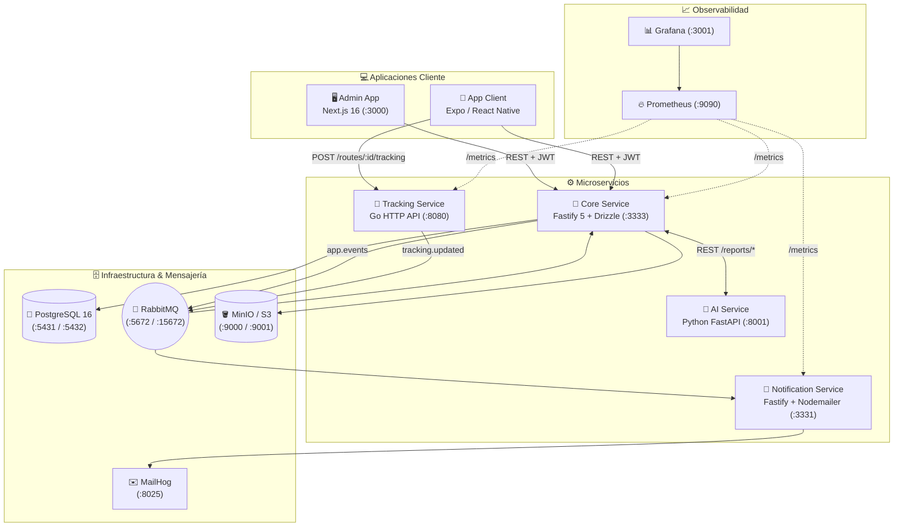

<div align="center">

<!-- Header Banner -->


<br />

<!-- Language Switcher -->
<p>
  
  <a href="./README.pt-BR.md">
    
  </a>
</p>

<!-- Navigation Action Buttons -->
<a href="#-arquitectura-del-sistema">
  
</a>
<a href="#-servicios-y-puertos">
  
</a>
<a href="#-inicio-r%C3%A1pido">
  
</a>
<a href="#-calidad-pruebas-y-m%C3%A9tricas">
  
</a>
<a href="./docs/README.md">
  
</a>
<a href="#-equipos-y-cr%C3%A9ditos">
  
</a>

<br /><br />

<!-- Quality & Status Badges -->


<br />

<!-- Tech Stack Badges -->


</div>

---

## 🚛 Sobre el Proyecto

**FlotaFacil — SIF (Sistema Integrado de Frotas)** es una plataforma distribuida diseñada para la **gestión digital de flotas municipales**, desarrollada en el contexto del Proyecto Integrador del **IFRN (Campus Pau dos Ferros)**.

El sistema digitaliza el ciclo completo de operación vehicular:

- 🔐 **Autenticación y RBAC:** acceso diferenciado para administradores (CPF + contraseña) y conductores (email + contraseña) mediante JWT.
- 🚗 **Gestión de Flota:** alta, edición, baja, control de disponibilidad por agenda y unicidad de placas.
- 📅 **Solicitudes y Aprobaciones:** creación de reservas con bloqueo anti-conflicto horario (vehículo y conductor), aprobación/rechazo administrativo y auditoría completa.
- 📍 **Rastreo GPS en Tiempo Real:** ingesta de coordenadas en Go publicada vía RabbitMQ, persistencia de rutas/tracks y mapas estáticos en almacenamiento S3/MinIO.
- 🤖 **Reportes Analíticos con IA:** generación automatizada de resúmenes ejecutivos de rutas y flota mediante FastAPI + OpenAI.
- 🔔 **Notificaciones y Observabilidad:** alertas por correo/push y monitoreo en vivo con métricas Prometheus, dashboards Grafana y pruebas de carga k6.

---

## 🏛️ Arquitectura del Sistema



---

## 🧩 Servicios y Puertos

| Servicio | Tecnología | Puerto Local | Responsabilidad | Documentación |
|---|---|---|---|---|
| **[`core-service`](./core-service/)** | Node.js 22, Fastify 5, Drizzle, PostgreSQL, Zod, Biome | `:3333` | API central: auth, RBAC, usuarios, vehículos, solicitudes, rutas, tracks, auditoría y reportes | [README](./core-service/README.md) |
| **[`admin-app`](./admin-app/)** | Next.js 16, React 19, Tailwind CSS 4, Playwright | `:3000` | Panel web administrativo para gestores de flota | [README](./admin-app/README.md) |
| **[`App-client`](./App-client/)** | Expo 54, React Native 0.81, TypeScript, Expo Router | Expo | App móvil para conductores (solicitudes, viajes y GPS en segundo plano) | [README](./App-client/README.md) |
| **[`tracking-service`](./tracking-service/)** | Go, `net/http`, AMQP (reconexión automática) | `:8080` | Ingesta de coordenadas GPS y publicación en RabbitMQ (`tracking.updated`) | [README](./tracking-service/README.md) |
| **[`ai-service`](./ai-service/)** | Python, FastAPI, Pydantic, OpenAI API, Pytest | `:8001` | Generación de reportes analíticos de rutas (`/reports/routes`) y flota (`/reports/fleet`) | [README](./ai-service/README.md) |
| **[`notification-service`](./notification-service/)** | Node.js, Fastify 5, `amqplib`, Nodemailer | `:3331` | Consumo de eventos de solicitudes y envío de notificaciones | [`package.json`](./notification-service/package.json) |
| **[`observability`](./observability/)** | Prometheus, Grafana, Nginx, k6 | `:9090` / `:3001` | Recolección de métricas, dashboards SIF y pruebas de carga/escalabilidad | [README](./observability/README.md) |

---

## 🚀 Inicio Rápido

> 📖 Para instrucciones detalladas de entorno, migraciones, troubleshooting y apagado seguro, consulta la [**Guía de Levantamiento del Proyecto**](./docs/equipo-2-pruebas/IniciarElProyecto/COMO_LEVANTAR_PROYECTO.md).

### 1. Levantar Backend Principal e Infraestructura (`core-service` + PostgreSQL + RabbitMQ + MinIO)

```bash
docker compose -f core-service/compose.dev.yml up -d
```

### 2. Levantar Microservicios Auxiliares y Observabilidad

```bash
docker compose -f notification-service/compose.yml up -d
docker compose -f tracking-service/docker-compose.yml up -d
docker compose -f ai-service/compose.yml up -d
docker compose -f observability/docker-compose.yml up -d
```

### 3. Iniciar el Panel Administrativo Web (`admin-app`)

```bash
cd admin-app
npm install
npm run dev
```

Abre en el navegador: **http://localhost:3000**

<details>
<summary>🔑 <strong>Ver accesos y credenciales locales de desarrollo</strong></summary>

<br />

| Servicio | URL / Dirección | Usuario / CPF | Contraseña |
|---|---|---|---|
| **Panel Web Admin (`admin-app`)** | `http://localhost:3000` | `000.000.000-00` | `123456` |
| **Core Service API** | `http://localhost:3333` | — | — |
| **PostgreSQL (`sif-dev`)** | `localhost:5431` | `postgres-dev` | `postgres-dev` |
| **RabbitMQ Management** | `http://localhost:15672` | `admin` | `admin` |
| **MinIO / S3 Console** | `http://localhost:9001` | `minioadmin` | `minioadmin` |
| **MailHog** | `http://localhost:8025` | *(sin login)* | *(sin login)* |
| **Prometheus** | `http://localhost:9090` | — | — |
| **Grafana** | `http://localhost:3001` | `admin` | `admin` |

</details>

---

## 🧪 Calidad, Pruebas y Métricas

El proyecto cuenta con una estrategia multipropósito ejecutada por el **Equipo 2 (QA)** que cubre pruebas unitarias, de componente HTTP, de mutación, E2E en navegador, resiliencia, observabilidad y carga:

| Capa / Servicio | Herramienta | Resultado Verificado | Cobertura / SLA | Informe / Evidencia |
|---|---|---|---|---|
| **Core Service (Integrada)** | Vitest + V8 + Biome + `tsc` | **`121 passed \| 21 skipped`** (`0` errores `tsc`/`lint`/`build`) | **`100%` V8** en los 15 módulos objetivo de David | [Relatoría David](./docs/equipo-2-pruebas/relatorios/relatorio_completo_test_david.md) · [Integración](./docs/equipo-2-pruebas/relatorios/relatorio_integracion.md) |
| **Core Service (Mutación)** | StrykerJS (`perTest`) | **`98.92%`** (`183/185` muertos, `0` sin cobertura) | **`100%`** en todos los `use-cases` (`135/135`) y `hooks` (`18/18`) | [Sección Fase 2](./docs/equipo-2-pruebas/relatorios/relatorio_completo_test_david.md#6-consolidación-final-y-validación-global-fase-2) |
| **Admin Web (E2E)** | Playwright (Chromium) | **`2/2 PASS`** (`TC-ADMIN-001` positivo + negativo) | Cookie `token` httpOnly + redirección `/` | [Evidencia E2E](./evidencias/TC-ADMIN-001/dashboard-authenticated.png) |
| **Tracking Service (Go)** | `go test` (`httptest` + AMQP) | **`100% PASS`** (`TC-TRACK-001..004` + reconexión `INC-ANDY-002`) | **`68.1%`** global (`internal/server`: `100%`, `reconnectLocked`: `100%`) | [Evidencia Tracking](./evidencias/TC-TRACK.txt) |
| **AI Service (Python)** | Pytest + `pytest-cov` | **`7/7 PASS`** (`TC-AI-001..002` + `/reports/fleet` `INC-ANDY-001`) | **`93.0%`** cobertura global (`app/`) | [Evidencia IA](./evidencias/TC-AI.txt) |
| **Observabilidad & Carga** | Prometheus + Grafana + k6 + Nginx | **`3/3` targets UP**, Smoke **`74/74`** checks, Load 1 vs 2 inst. | Smoke `p(95) = 131.21 ms` (`< 500 ms`), `0.00%` errores | [Resumen QA](./docs/equipo-2-pruebas/relatorios/04_RELATORIO_RESUMO.md) · [Carga k6](./evidencias/TC-OBS-003.md) |

<details>
<summary>⚡ <strong>Comandos para ejecutar las suites de prueba</strong></summary>

<br />

```bash
# Core Service (Vitest, Cobertura V8, Mutación StrykerJS, TypeScript, Biome y Build)
cd core-service
npm run test
npm run test:coverage
npm run test:mutation
npx tsc --noEmit && npm run lint && npm run build

# Tracking Service (Go)
cd tracking-service
go test -v -coverpkg=./internal/... ./...

# AI Service (Python / Pytest)
cd ai-service
pytest -v --cov=app

# Admin App E2E (Playwright — requiere core-service y admin-app activos)
cd admin-app
npx playwright test
```

</details>

---

## 📚 Centro de Documentación Unificada

Toda la documentación del repositorio fue consolidada dentro de **[`docs/`](./docs/README.md)** y organizada por equipo:

<table>
  <tr>
    <td width="50%" valign="top">
      <h4>🏗️ Equipo 1 — Desarrollo & Arquitectura</h4>
      <ul>
        <li><a href="./docs/equipo-1-desarrollo/">Explorar carpeta <code>docs/equipo-1-desarrollo/</code></a></li>
        <li><a href="./docs/equipo-1-desarrollo/Documentos%20de%20Requisitos%20-%20SIF.pdf">Documentos de Requisitos (RF001–RF016)</a></li>
        <li><a href="./docs/equipo-1-desarrollo/Casos%20de%20Uso%20-%20SIF.pdf">Casos de Uso — SIF</a></li>
        <li><a href="./docs/equipo-1-desarrollo/Diagrama%20Container%20-%20SIF.pdf">Diagramas C4 (Contexto, Container, Componentes)</a></li>
        <li><a href="./docs/equipo-1-desarrollo/Modelo%20L%C3%B3gico%20-%20SIF.pdf">Modelo Lógico y Diagrama de Clases</a></li>
        <li><a href="./docs/equipo-1-desarrollo/Relat%C3%B3rio%20de%20Processo%20de%20Software%20detalhado.pdf">Relatório de Processo (Scrumban)</a></li>
      </ul>
    </td>
    <td width="50%" valign="top">
      <h4>🧪 Equipo 2 — Calidad & Pruebas (QA)</h4>
      <ul>
        <li><a href="./docs/README.md"><strong>Abrir Hub Visual de Documentación (<code>docs/README.md</code>)</strong></a></li>
        <li><a href="./docs/equipo-2-pruebas/documentos-oficiales/Plano%20de%20Teste%20%E2%80%94%20SIF%20(Sistema%20Integrado%20de%20Frotas).pdf">Plano de Teste Oficial (PDF)</a></li>
        <li><a href="./docs/equipo-2-pruebas/documentos-oficiales/Casos%20de%20Teste%20%E2%80%94%20SIF.pdf">Casos de Teste Oficiales — 36 Casos (PDF)</a></li>
        <li><a href="./docs/equipo-2-pruebas/relatorios/relatorio_completo_test_david.md">Relatoría Completa Core Service (David Párraga)</a></li>
        <li><a href="./docs/equipo-2-pruebas/relatorios/03_RELATORIO_INCIDENTES.md">Relatório de Incidentes (Andy Merchán)</a> &amp; <a href="./docs/equipo-2-pruebas/relatorios/04_RELATORIO_RESUMO.md">Resumen (04)</a></li>
        <li><a href="./docs/equipo-2-pruebas/relatorios/relatorio_integracion.md">Relatoría de Integración de Ramas</a></li>
      </ul>
    </td>
  </tr>
</table>

---

## 👥 Equipos y Créditos

### 🏗️ Equipo 1 — Desarrollo de Software
| Integrante | Rol / Participación |
|---|---|
| **Everton Gean** | Desarrollo de Software — Sistema Integrado de Frotas (SIF) |
| **João Manoel** | Desarrollo de Software & Product Owner informal *(Relatório de Processo)* |
| **Sara Lima** | Desarrollo de Software *(y pruebas en Equipo 2)* |
| **Vitor Júnior** | Desarrollo de Software — Sistema Integrado de Frotas (SIF) |

### 🧪 Equipo 2 — Calidad y Pruebas de Software (QA)
| Integrante | Rol / Foco Principal | Rama de Trabajo |
|---|---|---|
| **David Párraga** | Pruebas `core-service` (`TC-CORE-001`..`014`), Cobertura V8, StrykerJS e Integración | `test/david-core-auth-fleet` |
| **Andy Merchán** | E2E `admin-app` (Playwright), `tracking-service` (Go), `ai-service` (Pytest), Observabilidad/k6 e Incidentes | `test/andy-web-observability-ai` |
| **Sara Lima** | Flujo de Solicitudes, Conflictos Horarios, Aprobación/Rechazo, Rutas y Tracks (`core-service` + PostgreSQL) | `test/sara-core-trips-rabbitmq` |

---

<div align="center">

**FlotaFacil — Sistema Integrado de Frotas (SIF)** · IFRN — Proyecto Integrador

<br />


</div>
