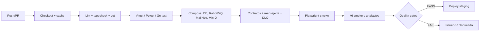

# Plano de Teste — SIF (Sistema Integrado de Frotas)

**Institución:** IFRN — Campus Pau dos Ferros  
**Versión:** 1.0 | **Fecha:** 2026-11-05 | **Fase:** 1ª entrega (planificación documental)

## 1. Propósito, alcance y trazabilidad

Este plan define la estrategia verificable para T1.1–T1.10, tomando como fuentes
`00_ROADMAP_ACCION.md`, `projeto_integrador_teste_de_software.md`,
`modelo_de_plano_de_teste.md`, los contratos Zod/handlers del código y la
documentación de requisitos de `documentation/`. Los resultados de ejecución quedan
pendientes para la 2ª entrega; los casos y requisitos están en
[`02_CASOS_DE_TESTE.md`](02_CASOS_DE_TESTE.md).

### 1.1 Alcance por microservicio (T1.1)

| Servicio | In scope | Límites y entradas observables |
|---|---|---|
| `core-service` (Fastify/TypeScript) | Autenticación, RBAC, usuarios, vehículos, solicitudes, rutas, tracks, auditoría, reportes, métricas y eventos RabbitMQ | HTTP en `:3333`, PostgreSQL, RabbitMQ, MinIO, servicios AI/LocationIQ |
| `notification-service` (Fastify/TypeScript) | Consumo de `notification.solicitation.created`, envío SMTP y `/metrics` | RabbitMQ y MailHog (`:1025`), HTTP en `:3331` |
| `tracking-service` (Go) | Salud, métricas, validación de coordenadas y publicación de tracking | HTTP `:8080`, exchange `tracking`, cola `tracking.coordinates.updated` |
| `ai-service` (FastAPI/Python) | Generación de reporte solicitada por core y respuestas de error | HTTP `:8001`, OpenAI (mock en pruebas) |
| `admin-app` (Next.js/React) | Login, autorización de navegación y flujos administrativos críticos | Navegador en `:3000`, proxy/API routes hacia core |
| observabilidad | Scrape de métricas y estado de tres targets | Prometheus `:9090`, Grafana `:3001` |

**Fuera de alcance de esta entrega:** pruebas de proveedor OpenAI/LocationIQ real,
compatibilidad móvil nativa de `App-client`, pruebas destructivas de producción,
seguridad ofensiva, rendimiento de terceros y cambios de código de aplicación.
Se validan contratos y errores mediante mocks controlados.

### 1.2 Requisitos trazables (T1.9)

| ID | Requisito / regla verificable | Fuente |
|---|---|---|
| RF-01 | Administrador y usuario se autentican y reciben token; rutas protegidas requieren JWT | `core-service/src/routes/auth-router.ts`, `hooks/verify-jwt.ts` |
| RF-02 | RBAC diferencia `ADMIN` y `USER` en recursos `/admin/*` | `hooks/authorize.ts`, routers |
| RF-03 | Vehículo tiene placa, modelo, año, odómetro, estado y tipo; placa duplicada se rechaza | `contracts/vehicles/register-vehicle-request-schema.ts`, use-cases |
| RF-04 | Solicitud exige vehículo, destino, motivo y fechas; fin debe ser posterior al inicio | `contracts/requests/create-my-request-schema.ts` |
| RF-05 | Solicitudes pasan por aprobación/rechazo y respetan conflictos de agenda | `routes/request-router.ts`, dominios de requests |
| RF-06 | Ruta se inicia y finaliza con descripción no vacía; eventos notifican cambios | `routes/route-router.ts`, `route-event-router.ts` |
| RF-07 | Tracking acepta coordenadas válidas y publica evento; límites latitud ±90 y longitud ±180 | `tracking-service/internal/handlers/tracking_handler.go` |
| RF-08 | Reporte de flota exige `routeId` UUID y delega generación AI | `contracts/reports/generate-fleet-report-schema.ts` |
| RF-09 | Eventos de solicitud y coordenadas se consumen sin pérdida; fallos deben ir a DLQ (objetivo T1.6) | `messaging/queues.ts`, roadmap T0.4/T1.6 |
| RF-10 | Métricas de core, tracking y notification deben estar disponibles y scrapeables | `plugins/metrics.ts`, `/metrics`, `prometheus.yml` |

## 2. Pirámide y matriz tecnológica (T1.2–T1.3)

La proporción objetivo es **70% unitarias, 20% integración/contrato/mensajería y
10% E2E/UI**. La base rápida aísla reglas Zod/use-cases/handlers; la capa
intermedia prueba PostgreSQL, RabbitMQ, MailHog, MinIO y contratos entre
microservicios; el ápice cubre sólo recorridos de negocio (login → solicitud →
aprobación → ruta). En una arquitectura distribuida, multiplicar UI tests sería
lento y frágil, mientras que los fallos de red, persistencia y colas sólo son
observables en integración. La cobertura se mide por servicio, no mezclando
líneas de un microservicio con otro.

| Nivel | Herramienta | Servicio/capa | Objetivo |
|---|---|---|---|
| Unitario | **Vitest** | core, notification, contratos y use-cases TS | Mocks de repositorios/AMQP; feedback rápido |
| Unitario | **Go test** (+ `go vet`) | handlers y publisher de tracking | Límites de coordenadas y errores deterministas |
| Unitario/integración | **Pytest** (+ pytest-cov) | endpoints y adaptadores de ai-service | Validar Pydantic/FastAPI; OpenAI mock |
| Integración | Vitest/Go test + Docker Compose | PostgreSQL, RabbitMQ, MinIO, MailHog | Persistencia, publicación/consumo y contratos |
| Sistema/UI | **Playwright** | admin-app en navegador Chromium | Flujos críticos y RBAC visibles |
| Carga | **k6** | core, tracking y notification | SLA, ramp-up y comparación 1 vs N instancias |
| Calidad estática | Biome, `tsc --noEmit`, `go vet`, Ruff/Flake8 | Cada repositorio | Bloquear defectos de compilación/estilo |

## 3. Criterios formales (T1.5–T1.7)

### 3.1 Unitarias
**Entrada:** commit de funcionalidad en `develop`/feature; dependencias instaladas
con lockfile; TypeScript, Go y Python sin errores sintácticos; datos y mocks
deterministas; pipeline habilitado.  
**Salida:** 100% de casos unitarios en verde (0 fallos); cobertura mínima **80%**
en use-cases/dominio/handlers; `biome check`, `tsc --noEmit`, `go vet` y Ruff sin
errores críticos. Un fallo o cobertura inferior bloquea la promoción.

### 3.2 Integración, contratos y mensajería
**Entrada:** `postgres-dev`, `rabbitmq-dev`, `minio-dev` y MailHog saludables;
migraciones Drizzle y seed aplicados; exchanges `app.events`/`tracking` y
contratos HTTP/eventos disponibles; reloj y zona horaria fijados en UTC.  
**Salida:** publicación y consumo E2E comprobados, persistencia PostgreSQL y
correo MailHog evidenciados; payload inválido no se pierde; consumidor fallido
envía a `.dlq` con `x-dead-letter-exchange`, permite reintento y no bloquea la
cola. La línea base actual documenta que todavía no existen DLX/DLQ: esa brecha
es un criterio de aceptación de la entrega de resiliencia, no un supuesto actual.

### 3.3 Carga y desempeño
**Entrada:** endpoints priorizados (`POST /auth`, `GET /vehicles/available`,
`POST /me/requests`, `POST /routes/{routeId}/tracking`); dataset seed; k6
parametrizado; entorno medido con 1 instancia y N instancias; dashboards de
Prometheus/Grafana operativos.  
**Salida:** smoke k6 sintácticamente válido y luego prueba comparativa. SLA:
`http_req_duration p(95) < 500 ms`, tasa de errores `< 1%`, disponibilidad
`>= 99%` durante la ventana; cada corrida registra VUs, ramp-up, duración,
CPU/memoria y versión. No se declara aprobado si falta una métrica.

## 4. CI/CD y flujo de evidencia (T1.4)

El workflow existente `core-service/.github/workflows/core-ci.yml` se dispara en
push/PR a `main` y `develop`, usa `ubuntu-latest` y Node 22.14, ejecuta `npm ci`,
test, build y lint. La evolución propuesta replica jobs por repositorio y agrega
Go/Python/Playwright/k6, servicios PostgreSQL/RabbitMQ y publicación de artefactos
de cobertura. Las credenciales son secretos del runner, nunca texto plano.

## 5. Datos, ambiente y responsabilidades (T1.8)

**Equipo:** QA/planificación mantiene trazabilidad; Automatización mantiene
Vitest/Pytest/Go/Playwright; Mensajería mantiene contratos, DLX/DLQ y MailHog;
Performance mantiene k6 y Grafana; CI/CD mantiene workflows y artefactos. Los
nombres se completan por el equipo IFRN.

**Ambiente:** Windows local con Docker Desktop para desarrollo, runner
`ubuntu-latest` para CI y staging aislado para ejecución final. Puertos: admin
3000, core 3333, tracking 8080, notification 3331, AI 8001, Prometheus 9090,
Grafana 3001. Navegador mínimo Chromium soportado por Playwright.

**Cronograma:** planificación y casos (T1.1–T1.10) en la 1ª entrega;
automatización, ejecución, carga, mutación, DLQ y regresión en la 2ª entrega;
incidentes y resumen al cierre. Cada caso se considera finalizado sólo cuando la
columna IFRN **Resultado de la Prueba** diga `Executado com sucesso` y exista
evidencia enlazada.

**Observaciones:** incidentes se registran en Issue/PR con ID de caso, severidad,
logs y reproducción. La evidencia debe mantener la cadena
requisito → caso → ejecución → incidente → corrección.

## 6. Matriz de entregables

| Tarea | Evidencia en este plan |
|---|---|
| T1.1–T1.2 | Alcance y pirámide §§1–2 |
| T1.3–T1.4 | Stack y CI §2/§4 |
| T1.5–T1.7 | Entry/Exit §3 |
| T1.8 | Estructura institucional §5 |
| T1.9 | RF-01–RF-10 §1.2 |
| T1.10 | 40 casos IFRN en `02_CASOS_DE_TESTE.md` |
