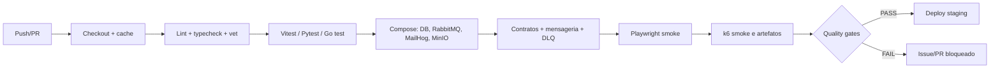

# Plano de Teste — SIF (Sistema Integrado de Frotas)

**Instituição:** IFRN — Campus Pau dos Ferros  
**Versão:** 1.0 | **Data:** 2026-11-05 | **Fase:** 1ª entrega (planejamento documental)

## 1. Objetivo, escopo e rastreabilidade

Este plano define a estratégia verificável para T1.1–T1.10, tendo como fontes
`00_ROADMAP_ACCION.md`, `projeto_integrador_teste_de_software.md`,
`modelo_de_plano_de_teste.md`, os contratos Zod/handlers do código e a
documentação de requisitos de `documentation/`. Os resultados de execução ficam
pendentes para a 2ª entrega; os casos e requisitos estão em
[`02_CASOS_DE_TESTE_PT.md`](02_CASOS_DE_TESTE_PT.md).

### 1.1 Escopo por microsserviço (T1.1)

| Serviço | In scope | Limites e entradas observáveis |
|---|---|---|
| `core-service` (Fastify/TypeScript) | Autenticação, RBAC, usuários, veículos, solicitações, rotas, tracks, auditoria, relatórios, métricas e eventos RabbitMQ | HTTP em `:3333`, PostgreSQL, RabbitMQ, MinIO, serviços IA/LocationIQ |
| `notification-service` (Fastify/TypeScript) | Consumo de `notification.solicitation.created`, envio SMTP e `/metrics` | RabbitMQ e MailHog (`:1025`), HTTP em `:3331` |
| `tracking-service` (Go) | Saúde, métricas, validação de coordenadas e publicação de rastreamento | HTTP `:8080`, exchange `tracking`, fila `tracking.coordinates.updated` |
| `ai-service` (FastAPI/Python) | Geração de relatório solicitada pelo core e respostas de erro | HTTP `:8001`, OpenAI (mock em testes) |
| `admin-app` (Next.js/React) | Login, autorização de navegação e fluxos administrativos críticos | Navegador em `:3000`, proxy/API routes para core |
| observabilidade | Coleta de métricas e status de três destinos | Prometheus `:9090`, Grafana `:3001` |

**Fora do escopo desta entrega:** testes do provedor OpenAI/LocationIQ real,
compatibilidade móvel nativa de `App-client`, testes destrutivos de produção,
segurança ofensiva, desempenho de terceiros e alterações no código da aplicação.
Os contratos e erros são validados por meio de mocks controlados.

### 1.2 Requisitos rastreáveis (T1.9)

| ID | Requisito / regra verificável | Fonte |
|---|---|---|
| RF-01 | Administrador e usuário se autenticam e recebem token; rotas protegidas exigem JWT | `core-service/src/routes/auth-router.ts`, `hooks/verify-jwt.ts` |
| RF-02 | RBAC diferença `ADMIN` e `USER` em recursos `/admin/*` | `hooks/authorize.ts`, routers |
| RF-03 | O veículo tem placa, modelo, ano, odómetro, status e tipo; placa duplicada é rejeitada | `contracts/vehicles/register-vehicle-request-schema.ts`, use-cases |
| RF-04 | A solicitação exige veículo, destino, motivo e datas; o fim deve ser posterior ao início | `contracts/requests/create-my-request-schema.ts` |
| RF-05 | As solicitações passam por aprovação/rejeição e respeitam conflitos de agenda | `routes/request-router.ts`, domínios de requests |
| RF-06 | A rota é iniciada e finalizada com descrição não vazia; eventos notificam alterações | `routes/route-router.ts`, `route-event-router.ts` |
| RF-07 | O rastreamento aceita coordenadas válidas e publica evento; limites de latitude ±90 e longitude ±180 | `tracking-service/internal/handlers/tracking_handler.go` |
| RF-08 | O relatório de frota exige `routeId` UUID e delegar a geração de IA | `contracts/reports/generate-fleet-report-schema.ts` |
| RF-09 | Eventos de solicitação e coordenadas são consumidos sem perda; falhas devem ir para a DLQ (objetivo T1.6) | `messaging/queues.ts`, roadmap T0.4/T1.6 |
| RF-10 | As métricas de core, tracking e notification devem estar disponíveis e ser coletáveis | `plugins/metrics.ts`, `/metrics`, `prometheus.yml` |

## 2. Pirâmide e matriz tecnológica (T1.2–T1.3)

A proporção alvo é **70% unitários, 20% integração/comtrato/mensageria e
10% E2E/UI**. A base rápida isola regras Zod/use-cases/handlers; a capa
intermediária testa PostgreSQL, RabbitMQ, MailHog, MinIO e contratos entre
microserviços; o ápice cobre apenas percursos de negócio (login → solicitação →
aprovação → rota). Em uma arquitetura distribuída, multiplicar UI tests seria
lento e frágil, enquanto as falhas de rede, persistência e filas somente são
observáveis em integração. A cobertura é medida por serviço, não misturando
linhas de um microserviço com outro.

| Nível | Ferramenta | Serviço/camada | Objetivo |
|---|---|---|---|
| Unitário | **Vitest** | core, notification, contratos e use-cases TS | Mocks de repositórios/AMQP; feedback rápido |
| Unitário | **Go test** (+ `go vet`) | handlers e publisher de tracking | Limites de coordenadas e erros deterministas |
| Unitário/integração | **Pytest** (+ pytest-cov) | endpoints e adaptadores de ai-service | Validar Pydantic/FastAPI; OpenAI mock |
| Integração | Vitest/Go test + Docker Compose | PostgreSQL, RabbitMQ, MinIO, MailHog | Persistência, publicação/consumo e contratos |
| Sistema/UI | **Playwright** | admin-app em navegador Chromium | Fluxos críticos e RBAC visíveis |
| Carga | **k6** | core, tracking e notification | SLA, ramp-up e comparación 1 vs N instâncias |
| Qualidade estática | Biome, `tsc --noEmit`, `go vet`, Ruff/Flake8 | Cada repositório | Bloquear defeitos de compilação/estilo |

## 3. Critérios formais (T1.5–T1.7)

### 3.1 Unitárias
**Entrada:** commit de funcionalidade em `develop`/feature; dependências instaladas
com lockfile; TypeScript, Go e Python sem erros sintáticos; dados e mocks
deterministas; pipeline habilitado.  
**Saída:** 100% de casos unitários verdes (0 falhas); cobertura mínima **80%**
em use-cases/domínio/handlers; `biome check`, `tsc --noEmit`, `go vet` e Ruff sem
erros críticos. Uma falha ou cobertura inferior bloqueia a promoção.

### 3.2 Integração, contratos e mensageria
**Entrada:** `postgres-dev`, `rabbitmq-dev`, `minio-dev` e MailHog saudáveis;
migrações Drizzle e seed aplicados; exchanges `app.events`/`tracking` e
contratos HTTP/eventos disponíveis; relógio e fuso horário fixados em UTC.  
**Saída:** publicação e consumo E2E comprovados, persistência PostgreSQL e
e-mail MailHog evidenciados; payload inválido não é perdido; consumidor com falha
envia a `.dlq` com `x-dead-letter-exchange`, permite nova tentativa e não bloqueia a
fila. A linha base atual documenta que ainda não existem DLX/DLQ: essa lacuna
é um critério de aceitação da entrega de resiliência, não uma suposição atual.

### 3.3 Carga e desempenho
**Entrada:** endpoints priorizados (`POST /auth`, `GET /vehicles/available`,
`POST /me/requests`, `POST /routes/{routeId}/tracking`); dataset seed; k6
parametrizado; ambiente medido com 1 instância e N instâncias; dashboards de
Prometheus/Grafana operativos.  
**Saída:** smoke k6 sintaticamente válido e depois teste comparativo. SLA:
`http_req_duration p(95) < 500 ms`, taxa de erros `< 1%`, disponibilidade
`>= 99%` durante a janela; cada execução registra VUs, ramp-up, duração,
CPU/memória e versão. Não se declara aprovado se faltar uma métrica.

## 4. CI/CD e fluxo de evidências (T1.4)

O workflow existente `core-service/.github/workflows/core-ci.yml` é acionado em
push/PR a `main` e `develop`, usa `ubuntu-latest` e Node 22.14, executa `npm ci`,
test, build e lint. A evolução proposta replica jobs por repositório e adiciona
Go/Python/Playwright/k6, serviços PostgreSQL/RabbitMQ e publicação de artefatos
de cobertura. As credenciais são segredos do runner, nunca texto simples.

## 5. Dados, ambiente e responsabilidades (T1.8)

**Equipe:** QA/planejamento mantém rastreabilidade; Automação mantém
Vitest/Pytest/Go/Playwright; Mensageria mantém contratos, DLX/DLQ e MailHog;
Performance mantém k6 e Grafana; CI/CD mantém workflows e artefatos. Os nomes são completados pela equipe IFRN.

**Ambiente:** Windows local com Docker Desktop para desenvolvimento, runner
`ubuntu-latest` para CI e staging isolado para execução final. Portas: admin
3000, core 3333, tracking 8080, notification 3331, IA 8001, Prometheus 9090,
Grafana 3001. Navegador mínimo Chromium suportado por Playwright.

**Cronograma:** planejamento e casos (T1.1–T1.10) em à 1ª entrega;
automação, execução, carga, mutação, DLQ e regressão em à 2ª entrega;
incidentes e resumo ao final. Cada caso é comsiderado finalizado somente quando a
coluna IFRN **Resultado da Prova** diga `Executado com sucesso` e exista
evidência vinculada.

**Observações:** incidentes são registrados em Issue/PR com ID de caso, severidade,
logs e reprodução. A evidência deve manter a cadeia
requisito → caso → execução → incidente → correção.

## 6. Matriz de entregáveis

| Tarefa | Evidência neste plano |
|---|---|
| T1.1–T1.2 | Escopo e pirâmide §§1–2 |
| T1.3–T1.4 | Stack e CI §2/§4 |
| T1.5–T1.7 | Entry/Exit §3 |
| T1.8 | Estrutura institucional §5 |
| T1.9 | RF-01–RF-10 §1.2 |
| T1.10 | 40 casos IFRN em `02_CASOS_DE_TESTE_PT.md` |
