<div align="center">

<!-- Banner Header -->


<br />

<!-- Navigation Buttons -->
<a href="../README.md">
  
</a>
<a href="#-equipo-1--ingenier%C3%ADa-y-desarrollo-de-software">
  
</a>
<a href="#-equipo-2--calidad-pruebas-y-validaci%C3%B3n-qa">
  
</a>
<a href="#-documentos-oficiales-rectores-pdf">
  
</a>
<a href="#-relator%C3%ADas-e-informes-de-ejecuci%C3%B3n">
  
</a>
<a href="../evidencias/">
  
</a>

<br /><br />


</div>

---

## 🧭 Visión General del Centro de Documentación

Esta carpeta centraliza **toda la documentación técnica y académica** del **Sistema Integrado de Frotas (SIF / FlotaFacil)**, separada de forma clara según la responsabilidad de cada equipo del Proyecto Integrador:

```mermaid
flowchart LR
    subgraph E1["🏗️ Equipo 1 — Desarrollo & Arquitectura"]
        direction TB
        R1["Documentos de Requisitos (RF001–RF016)"]
        R2["Casos de Uso, C4 y Diagramas"]
        R3["Proceso Scrumban y Modelo Lógico"]
    end

    subgraph E2["🧪 Equipo 2 — Calidad & Pruebas (QA)"]
        direction TB
        Q1["Plano de Teste & Casos de Teste (PDF Oficiales)"]
        Q2["Suites Automatizadas (Vitest, Stryker, Playwright, Pytest, Go, k6)"]
        Q3["Relatorías Técnicas, Incidentes e Integración"]
    end

    subgraph EV["📊 Evidencias y Entrega"]
        direction TB
        V1["evidencias/ (Playwright, k6, Grafana, Go, AI)"]
        V2["Rama test/integracion → main"]
    end

    E1 ==>|"Base de requisitos y contratos"| E2
    E2 ==>|"Verificación, regresión y trazabilidad"| EV
```



---

## 👥 Organización por Equipos

<table>
  <tr>
    <td width="50%" valign="top">
      <h3>🏗️ Equipo 1 — Desarrollo y Código</h3>
      <p>Responsable del levantamiento de requisitos, arquitectura de microservicios, modelado de datos, proceso Scrumban e implementación del sistema SIF (<code>core-service</code>, <code>admin-app</code>, <code>App-client</code>, <code>tracking-service</code>, <code>ai-service</code>, <code>notification-service</code>).</p>
      <ul>
        <li><strong>Carpeta asignada:</strong> <a href="./equipo-1-desarrollo/"><code>docs/equipo-1-desarrollo/</code></a></li>
        <li><strong>Integrantes registrados:</strong>
          <ul>
            <li><strong>João Manoel</strong> <em>(Product Owner informal — según Relatório de Processo)</em></li>
            <li><em>(Resto de integrantes del Equipo 1 pendientes de completar con nombres oficiales)</em></li>
          </ul>
        </li>
      </ul>
    </td>
    <td width="50%" valign="top">
      <h3>🧪 Equipo 2 — Calidad y Pruebas (QA / Testing)</h3>
      <p>Responsable del Plan de Pruebas, diseño y ejecución de casos de prueba, pruebas de mutación, cobertura, E2E, observabilidad/carga, gestión de incidentes y validación de integración.</p>
      <ul>
        <li><strong>Carpeta asignada:</strong> <a href="./equipo-2-pruebas/"><code>docs/equipo-2-pruebas/</code></a></li>
        <li><strong>Integrantes:</strong>
          <ul>
            <li><strong>David Párraga</strong> — <code>core-service</code> (Auth, RBAC, Usuarios, Vehículos, Solicitudes, Cobertura V8, StrykerJS e Integración)</li>
            <li><strong>Andy Merchán</strong> — <code>admin-app</code> (Playwright E2E), <code>tracking-service</code> (Go), <code>ai-service</code> (Pytest), <code>observability</code> (Prometheus, Grafana, k6) y Gestión de Incidentes</li>
            <li><strong>Sara Lima</strong> — <code>core-service</code> (Flujo de Solicitudes, Conflictos Horarios, Aprobación/Rechazo, Inicio/Fin de Rutas y Tracks en PostgreSQL)</li>
          </ul>
        </li>
      </ul>
    </td>
  </tr>
</table>

---

## 🏗️ Equipo 1 — Ingeniería y Desarrollo de Software

> 📁 Ubicación: [`docs/equipo-1-desarrollo/`](./equipo-1-desarrollo/) *(anteriormente `documentation/`)*

### 📋 Requisitos, Casos de Uso y Proceso de Software

| Documento | Categoría | Descripción | Acceso |
|---|---|---|---|
| **Documentos de Requisitos — SIF** | Requisitos | Historias de usuario (`RF001`–`RF016`), actores y criterios de aceptación | [Abrir PDF](<./equipo-1-desarrollo/Documentos de Requisitos - SIF.pdf>) |
| **Casos de Uso — SIF** | Modelado | Diagramas y especificación de casos de uso del sistema | [Abrir PDF](<./equipo-1-desarrollo/Casos de Uso - SIF.pdf>) |
| **Definição do Processo de Software 01** | Proceso | Definición inicial ágil basada en Kanban y tablero GitHub Projects | [Abrir PDF](<./equipo-1-desarrollo/Definição do Processo de Software 01- SIF.pdf>) |
| **Relatório de Processo de Software Detalhado** | Proceso | Evolución a **Scrumban**, sprints quincenales, roles y ceremonias | [Abrir PDF](<./equipo-1-desarrollo/Relatório de Processo de Software detalhado.pdf>) |

### 🏛️ Arquitectura (Modelo C4), Datos y Vistas Técnicas

| Documento | Categoría | Descripción | Acceso |
|---|---|---|---|
| **Diagrama de Contexto — SIF** | C4 — Nivel 1 | Actores externos y contexto global del sistema | [Abrir PDF](<./equipo-1-desarrollo/Diagrama Contexto - SIF.pdf>) |
| **Diagrama de Container — SIF** | C4 — Nivel 2 | Microservicios, aplicaciones cliente, bases de datos y colas | [Abrir PDF](<./equipo-1-desarrollo/Diagrama Container - SIF.pdf>) |
| **Diagrama de Componentes — SIF** | C4 — Nivel 3 | Desglose interno de componentes por servicio | [Abrir PDF](<./equipo-1-desarrollo/Diagrama Componentes - SIF.pdf>) |
| **Visão Funcional** | Arquitectura | Integración funcional entre `Core`, `Tracking`, `IA`, `Admin` y `Notification` | [Abrir PDF](<./equipo-1-desarrollo/Visão Funcional.pdf>) |
| **Descrição Detalhada dos Serviços** | Arquitectura | Responsabilidades detalladas de cada microservicio | [Abrir PDF](<./equipo-1-desarrollo/Descrição Detalhada dos Serviços - SIF.pdf>) |
| **Diagrama de Classe — SIF** | Dominio | Modelo de clases del dominio del sistema | [Ver PNG](<./equipo-1-desarrollo/Diagrama de classe - SIF.png>) |
| **Modelo Lógico — SIF** | Base de Datos | Esquema relacional lógico de PostgreSQL | [Abrir PDF](<./equipo-1-desarrollo/Modelo Lógico - SIF.pdf>) |
| **Visão de Desenvolvimento — Fastify** | Backend TS | Estructura y patrones de desarrollo de `core-service` | [Abrir PDF](<./equipo-1-desarrollo/Visão de Desenvolvimento - Fastify.pdf>) |
| **Visão de Desenvolvimento — FastAPI** | Servicio IA | Estructura y patrones de desarrollo de `ai-service` | [Abrir PDF](<./equipo-1-desarrollo/Visão de Desenvolvimento - FastApi.pdf>) |

---

## 🧪 Equipo 2 — Calidad, Pruebas y Validación (QA)

> 📁 Ubicación: [`docs/equipo-2-pruebas/`](./equipo-2-pruebas/)

### 📄 Documentos Oficiales Rectores (PDF)

| Documento Oficial | Descripción | Acceso |
|---|---|---|
| **Plano de Teste — SIF (Sistema Integrado de Frotas)** | Plan maestro oficial: estrategia, niveles de prueba, criterios de salida (`>= 80%` cobertura y mutación) y trazabilidad | [Abrir PDF](<./equipo-2-pruebas/documentos-oficiales/Plano de Teste — SIF (Sistema Integrado de Frotas).pdf>) |
| **Casos de Teste — SIF** | Matriz oficial de **36 casos de prueba** (IDs, precondiciones, roteiros y resultados esperados) | [Abrir PDF](<./equipo-2-pruebas/documentos-oficiales/Casos de Teste — SIF.pdf>) |

### 📊 Relatorías e Informes de Ejecución (2ª Entrega)

| Relatoría | Responsable | Contenido Principal | Acceso |
|---|---|---|---|
| **Relatoría Completa — Core Service** | **David Párraga** | Auditoría paso a paso de los 13 casos (`TC-CORE-001`..`014`), cobertura V8 **`100%`** en los 15 módulos objetivo y **`98.92%`** Mutation Score en StrykerJS | [Leer Relatoría](./equipo-2-pruebas/relatorios/relatorio_completo_test_david.md) |
| **Relatório de Incidentes (03)** | **Andy Merchán** | Registro y resolución con regresión de `INC-ANDY-001` (`/reports/fleet` + `502`), `INC-ANDY-002` (reconexión AMQP Go) e `INC-ANDY-003` | [Leer Informe](./equipo-2-pruebas/relatorios/03_RELATORIO_INCIDENTES.md) |
| **Relatório Resumo de Testes (04)** | **Andy Merchán** | Balance numérico (`11/11` aprobados), cobertura `ai-service` (`93%`), `tracking-service` (`68.1%`), Playwright E2E, Prometheus, Grafana y k6 | [Leer Resumen](./equipo-2-pruebas/relatorios/04_RELATORIO_RESUMO.md) |
| **Relatoría de Integración de Ramas** | **Equipo 2** | Estrategia de `test/integracion`, errores de `tsc`/`biome` detectados al unir las 3 ramas, corrección (`17f5e6c`), revalidación PR `#2` (`121` tests en verde) e impacto en el flujo | [Leer Relatoría](./equipo-2-pruebas/relatorios/relatorio_integracion.md) |
| **Relatoría Inicial Histórica (`b2d6811`)** | **David Párraga** | Registro histórico preservado de la primera iteración previa a la auditoría con StrykerJS/V8 | [Ver Histórico](./equipo-2-pruebas/relatorios/historico/RELATORIA_TESTES_DAVID.md) |

### 🗂️ Entregables de Planificación, Guías y Diagnóstico

| Documento | Carpeta | Idioma / Propósito | Acceso |
|---|---|---|---|
| **Guía: Cómo Levantar y Apagar el Proyecto** | `IniciarElProyecto/` | Paso a paso Docker Compose, puertos, credenciales y troubleshooting | [Abrir Guía](./equipo-2-pruebas/IniciarElProyecto/COMO_LEVANTAR_PROYECTO.md) |
| **Plan de Pruebas (1ª Entrega)** | `01_PRIMEIRA_ENTREGA/` | Versión Markdown en [Español](./equipo-2-pruebas/01_PRIMEIRA_ENTREGA/01_PLANO_DE_TESTE.md) y [Portugués](./equipo-2-pruebas/01_PRIMEIRA_ENTREGA/01_PLANO_DE_TESTE_PT.md) | `ES` / `PT` |
| **Casos de Prueba (1ª Entrega)** | `01_PRIMEIRA_ENTREGA/` | Matriz extendida en [Español](./equipo-2-pruebas/01_PRIMEIRA_ENTREGA/02_CASOS_DE_TESTE.md) y [Portugués](./equipo-2-pruebas/01_PRIMEIRA_ENTREGA/02_CASOS_DE_TESTE_PT.md) | `ES` / `PT` |
| **Roadmap de Acción** | `RoadMap/` | Plan operativo de ejecución en [Español](./equipo-2-pruebas/RoadMap/00_ROADMAP_ACCION.md) y [Portugués](./equipo-2-pruebas/RoadMap/00_ROADMAP_ACAO.md) | `ES` / `PT` |
| **Diagnóstico Fase 0** | `equipo-2-pruebas/` | Reconocimiento técnico inicial de servicios, contratos y riesgos | [Abrir Diagnóstico](./equipo-2-pruebas/FASE0_DIAGNOSTICO.md) |
| **Base Académica del Proyecto** | `ProyectoIntegrador/` | [Modelo de Plano de Teste](./equipo-2-pruebas/ProyectoIntegrador/modelo_de_plano_de_teste.md) y [Especificación del Proyecto Integrador](./equipo-2-pruebas/ProyectoIntegrador/projeto_integrador_teste_de_software.md) | `PT` |

---

## 📂 Mapa Completo de la Carpeta `docs/`

```text
docs/
├── README.md                                                     # Este hub de documentación
├── equipo-1-desarrollo/                                          # Arquitectura, requisitos y proceso (Equipo 1)
│   ├── Casos de Uso - SIF.pdf
│   ├── Definição do Processo de Software 01- SIF.pdf
│   ├── Descrição Detalhada dos Serviços - SIF.pdf
│   ├── Diagrama Componentes - SIF.pdf
│   ├── Diagrama Container - SIF.pdf
│   ├── Diagrama Contexto - SIF.pdf
│   ├── Diagrama de classe - SIF.png
│   ├── Documentos de Requisitos - SIF.pdf
│   ├── Modelo Lógico - SIF.pdf
│   ├── Relatório de Processo de Software detalhado.pdf
│   ├── Visão de Desenvolvimento - FastApi.pdf
│   ├── Visão de Desenvolvimento - Fastify.pdf
│   └── Visão Funcional.pdf
└── equipo-2-pruebas/                                             # Calidad, pruebas y relatorías (Equipo 2)
    ├── documentos-oficiales/
    │   ├── Casos de Teste — SIF.pdf
    │   └── Plano de Teste — SIF (Sistema Integrado de Frotas).pdf
    ├── relatorios/
    │   ├── 03_RELATORIO_INCIDENTES.md
    │   ├── 04_RELATORIO_RESUMO.md
    │   ├── relatorio_completo_test_david.md
    │   ├── relatorio_integracion.md
    │   └── historico/
    │       └── RELATORIA_TESTES_DAVID.md
    ├── 01_PRIMEIRA_ENTREGA/
    ├── IniciarElProyecto/
    ├── ProyectoIntegrador/
    ├── RoadMap/
    └── FASE0_DIAGNOSTICO.md
```

---

<div align="center">

<a href="../README.md">
  
</a>

<br />


</div>
