<div align="center">

<!-- Banner Header -->


<br />

<!-- Language Switcher -->
<p>
  <a href="./README.md">
    
  </a>
  
</p>

<!-- Navigation Buttons -->
<a href="../README.pt-BR.md">
  
</a>
<a href="#-equipe-1--engenharia-e-desenvolvimento-de-software">
  
</a>
<a href="#-equipe-2--qualidade-testes-e-valida%C3%A7%C3%A3o-qa">
  
</a>
<a href="#-documentos-oficiais-reitores-pdf">
  
</a>
<a href="#-relat%C3%B3rios-de-execu%C3%A7%C3%A3o-2%C2%AA-entrega">
  
</a>
<a href="../evidencias/">
  
</a>

<br /><br />


</div>

---

## 🧭 Visão Geral da Central de Documentação

Esta pasta centraliza **toda a documentação técnica e acadêmica** do **Sistema Integrado de Frotas (SIF / FlotaFacil)**, separada de forma clara conforme a responsabilidade de cada equipe do Projeto Integrador:

```mermaid
flowchart LR
    subgraph E1["🏗️ Equipe 1 — Desenvolvimento & Arquitetura"]
        direction TB
        R1["Documentos de Requisitos (RF001–RF016)"]
        R2["Casos de Uso, C4 e Diagramas"]
        R3["Processo Scrumban e Modelo Lógico"]
    end

    subgraph E2["🧪 Equipe 2 — Qualidade & Testes (QA)"]
        direction TB
        Q1["Plano de Teste & Casos de Teste (PDFs Oficiais)"]
        Q2["Suítes Automatizadas (Vitest, Stryker, Playwright, Pytest, Go, k6)"]
        Q3["Relatórios Técnicos, Incidentes e Integração"]
    end

    subgraph EV["📊 Evidências e Entrega"]
        direction TB
        V1["evidencias/ (Playwright, k6, Grafana, Go, AI)"]
        V2["Branch test/integracion → main"]
    end

    E1 ==>|"Base de requisitos e contratos"| E2
    E2 ==>|"Verificação, regressão e rastreabilidade"| EV
```



---

## 👥 Organização por Equipes

<table>
  <tr>
    <td width="50%" valign="top">
      <h3>🏗️ Equipe 1 — Desenvolvimento e Código</h3>
      <p>Responsável pelo levantamento de requisitos, arquitetura de microsserviços, modelagem de dados, processo Scrumban e implementação do sistema SIF (<code>core-service</code>, <code>admin-app</code>, <code>App-client</code>, <code>tracking-service</code>, <code>ai-service</code>, <code>notification-service</code>).</p>
      <ul>
        <li><strong>Pasta atribuída:</strong> <a href="./equipo-1-desarrollo/"><code>docs/equipo-1-desarrollo/</code></a></li>
        <li><strong>Integrantes:</strong>
          <ul>
            <li><strong>Everton Gean</strong></li>
            <li><strong>João Manoel</strong> <em>(Product Owner informal — Relatório de Processo)</em></li>
            <li><strong>Sara Lima</strong></li>
            <li><strong>Vitor Júnior</strong></li>
          </ul>
        </li>
      </ul>
    </td>
    <td width="50%" valign="top">
      <h3>🧪 Equipe 2 — Qualidade e Testes (QA / Testing)</h3>
      <p>Responsável pelo Plano de Teste, projeto e execução de casos de teste, testes de mutação, cobertura, E2E, observabilidade/carga, gestão de incidentes e validação de integração.</p>
      <ul>
        <li><strong>Pasta atribuída:</strong> <a href="./equipo-2-pruebas/"><code>docs/equipo-2-pruebas/</code></a></li>
        <li><strong>Integrantes:</strong>
          <ul>
            <li><strong>David Párraga</strong> — <code>core-service</code> (Auth, RBAC, Usuários, Veículos, Solicitações, Cobertura V8, StrykerJS e Integração)</li>
            <li><strong>Andy Merchán</strong> — <code>admin-app</code> (Playwright E2E), <code>tracking-service</code> (Go), <code>ai-service</code> (Pytest), <code>observability</code> (Prometheus, Grafana, k6) e Gestão de Incidentes</li>
            <li><strong>Sara Lima</strong> — <code>core-service</code> (Fluxo de Solicitações, Conflitos de Horário, Aprovação/Recusa, Início/Fim de Rotas e Tracks em PostgreSQL)</li>
          </ul>
        </li>
      </ul>
    </td>
  </tr>
</table>

---

## 🏗️ Equipe 1 — Engenharia e Desenvolvimento de Software

> 📁 Localização: [`docs/equipo-1-desarrollo/`](./equipo-1-desarrollo/) *(anteriormente `documentation/`)*

### 📋 Requisitos, Casos de Uso e Processo de Software

| Documento | Categoria | Descrição | Acesso |
|---|---|---|---|
| **Documentos de Requisitos — SIF** | Requisitos | Histórias de usuário (`RF001`–`RF016`), atores e critérios de aceitação | [Abrir PDF](<./equipo-1-desarrollo/Documentos de Requisitos - SIF.pdf>) |
| **Casos de Uso — SIF** | Modelagem | Diagramas e especificação de casos de uso do sistema | [Abrir PDF](<./equipo-1-desarrollo/Casos de Uso - SIF.pdf>) |
| **Definição do Processo de Software 01** | Processo | Definição inicial ágil baseada em Kanban e quadro GitHub Projects | [Abrir PDF](<./equipo-1-desarrollo/Definição do Processo de Software 01- SIF.pdf>) |
| **Relatório de Processo de Software Detalhado** | Processo | Evolução para **Scrumban**, sprints quinzenais, papéis e cerimônias | [Abrir PDF](<./equipo-1-desarrollo/Relatório de Processo de Software detalhado.pdf>) |

### 🏛️ Arquitetura (Modelo C4), Dados e Visões Técnicas

| Documento | Categoria | Descrição | Acesso |
|---|---|---|---|
| **Diagrama de Contexto — SIF** | C4 — Nível 1 | Atores externos e contexto global do sistema | [Abrir PDF](<./equipo-1-desarrollo/Diagrama Contexto - SIF.pdf>) |
| **Diagrama de Container — SIF** | C4 — Nível 2 | Microsserviços, aplicações cliente, bancos de dados e filas | [Abrir PDF](<./equipo-1-desarrollo/Diagrama Container - SIF.pdf>) |
| **Diagrama de Componentes — SIF** | C4 — Nível 3 | Detalhamento interno de componentes por serviço | [Abrir PDF](<./equipo-1-desarrollo/Diagrama Componentes - SIF.pdf>) |
| **Visão Funcional** | Arquitetura | Integração funcional entre `Core`, `Tracking`, `IA`, `Admin` e `Notification` | [Abrir PDF](<./equipo-1-desarrollo/Visão Funcional.pdf>) |
| **Descrição Detalhada dos Serviços** | Arquitetura | Responsabilidades detalhadas de cada microsserviço | [Abrir PDF](<./equipo-1-desarrollo/Descrição Detalhada dos Serviços - SIF.pdf>) |
| **Diagrama de Classe — SIF** | Domínio | Modelo de classes do domínio do sistema | [Ver PNG](<./equipo-1-desarrollo/Diagrama de classe - SIF.png>) |
| **Modelo Lógico — SIF** | Banco de Dados | Esquema relacional lógico do PostgreSQL | [Abrir PDF](<./equipo-1-desarrollo/Modelo Lógico - SIF.pdf>) |
| **Visão de Desenvolvimento — Fastify** | Backend TS | Estrutura e padrões de desenvolvimento do `core-service` | [Abrir PDF](<./equipo-1-desarrollo/Visão de Desenvolvimento - Fastify.pdf>) |
| **Visão de Desenvolvimento — FastAPI** | Serviço IA | Estrutura e padrões de desenvolvimento do `ai-service` | [Abrir PDF](<./equipo-1-desarrollo/Visão de Desenvolvimento - FastApi.pdf>) |

---

## 🧪 Equipe 2 — Qualidade, Testes e Validação (QA)

> 📁 Localização: [`docs/equipo-2-pruebas/`](./equipo-2-pruebas/)

### 📄 Documentos Oficiais Reitores (PDF)

| Documento Oficial | Descrição | Acesso |
|---|---|---|
| **Plano de Teste — SIF (Sistema Integrado de Frotas)** | Plano mestre oficial: estratégia, níveis de teste, critérios de saída (`>= 80%` cobertura e mutação) e rastreabilidade | [Abrir PDF](<./equipo-2-pruebas/documentos-oficiales/Plano de Teste — SIF (Sistema Integrado de Frotas).pdf>) |
| **Casos de Teste — SIF** | Matriz oficial de **36 casos de teste** (IDs, pré-condições, roteiros e resultados esperados) | [Abrir PDF](<./equipo-2-pruebas/documentos-oficiales/Casos de Teste — SIF.pdf>) |

### 📊 Relatórios de Execução (2ª Entrega)

| Relatório | Responsável | Conteúdo Principal | Acesso |
|---|---|---|---|
| **Relatório Completo — Core Service** | **David Párraga** | Auditoria passo a passo dos 13 casos (`TC-CORE-001`..`014`), cobertura V8 **`100%`** nos 15 módulos alvo e **`98.92%`** Mutation Score no StrykerJS | [Ler Relatório](./equipo-2-pruebas/relatorios/relatorio_completo_test_david.md) |
| **Relatório de Incidentes (03)** | **Andy Merchán** | Registro e resolução com regressão de `INC-ANDY-001` (`/reports/fleet` + `502`), `INC-ANDY-002` (reconexão AMQP Go) e `INC-ANDY-003` | [Ler Relatório](./equipo-2-pruebas/relatorios/03_RELATORIO_INCIDENTES.md) |
| **Relatório Resumo de Testes (04)** | **Andy Merchán** | Balanço numérico (`11/11` aprovados), cobertura `ai-service` (`93%`), `tracking-service` (`68.1%`), Playwright E2E, Prometheus, Grafana e k6 | [Ler Resumo](./equipo-2-pruebas/relatorios/04_RELATORIO_RESUMO.md) |
| **Relatório de Integração de Branches** | **Equipe 2** | Estratégia de `test/integracion`, erros de `tsc`/`biome` detectados ao unir as 3 branches, correção (`17f5e6c`), revalidação PR `#2` (`121` testes em verde) e impacto no fluxo | [Ler Relatório](./equipo-2-pruebas/relatorios/relatorio_integracion.md) |
| **Relatório Inicial Histórico (`b2d6811`)** | **David Párraga** | Registro histórico preservado da primeira iteração anterior à auditoria com StrykerJS/V8 | [Ver Histórico](./equipo-2-pruebas/relatorios/historico/RELATORIA_TESTES_DAVID.md) |

### 🗂️ Entregáveis de Planejamento, Guias e Diagnóstico

| Documento | Pasta | Idioma / Propósito | Acesso |
|---|---|---|---|
| **Guia: Como Subir e Desligar o Projeto** | `IniciarElProyecto/` | Passo a passo Docker Compose, portas, credenciais e troubleshooting | [Abrir Guia](./equipo-2-pruebas/IniciarElProyecto/COMO_LEVANTAR_PROYECTO.md) |
| **Plano de Teste (1ª Entrega)** | `01_PRIMEIRA_ENTREGA/` | Versão Markdown em [Português](./equipo-2-pruebas/01_PRIMEIRA_ENTREGA/01_PLANO_DE_TESTE_PT.md) e [Espanhol](./equipo-2-pruebas/01_PRIMEIRA_ENTREGA/01_PLANO_DE_TESTE.md) | `PT` / `ES` |
| **Casos de Teste (1ª Entrega)** | `01_PRIMEIRA_ENTREGA/` | Matriz estendida em [Português](./equipo-2-pruebas/01_PRIMEIRA_ENTREGA/02_CASOS_DE_TESTE_PT.md) e [Espanhol](./equipo-2-pruebas/01_PRIMEIRA_ENTREGA/02_CASOS_DE_TESTE.md) | `PT` / `ES` |
| **Roadmap de Ação** | `RoadMap/` | Plano operacional de execução em [Português](./equipo-2-pruebas/RoadMap/00_ROADMAP_ACAO.md) e [Espanhol](./equipo-2-pruebas/RoadMap/00_ROADMAP_ACCION.md) | `PT` / `ES` |
| **Diagnóstico Fase 0** | `equipo-2-pruebas/` | Reconhecimento técnico inicial de serviços, contratos e riscos | [Abrir Diagnóstico](./equipo-2-pruebas/FASE0_DIAGNOSTICO.md) |
| **Base Acadêmica do Projeto** | `ProyectoIntegrador/` | [Modelo de Plano de Teste](./equipo-2-pruebas/ProyectoIntegrador/modelo_de_plano_de_teste.md) e [Especificação do Projeto Integrador](./equipo-2-pruebas/ProyectoIntegrador/projeto_integrador_teste_de_software.md) | `PT` |

---

## 📂 Mapa Completo da Pasta `docs/`

```text
docs/
├── README.md                                                     # Central de documentação (Espanhol)
├── README.pt-BR.md                                               # Central de documentação (Português)
├── equipo-1-desarrollo/                                          # Arquitetura, requisitos e processo (Equipe 1)
│   ├── Casos de Uso - SIF.pdf
│   ├── Definição do Processo de Software 01- SIF.pdf
│   ├── Descrição Detalhada dos Serviços - SIF.pdf
│   ├── Diagrama Componentes - SIF.pdf
│   ├── Diagrama Container - SIF.pdf
│   ├── Diagrama Contexto - SIF.pdf
│   ├── Diagrama de classe - SIF.png
│   ├── Documentos de Requisitos - SIF.pdf
│   ├── Modelo Lógico - SIF.pdf
│   ├── Relatório de Processo de Software detalhado.pdf
│   ├── Visão de Desenvolvimento - FastApi.pdf
│   ├── Visão de Desenvolvimento - Fastify.pdf
│   └── Visão Funcional.pdf
└── equipo-2-pruebas/                                             # Qualidade, testes e relatórios (Equipe 2)
    ├── documentos-oficiales/
    │   ├── Casos de Teste — SIF.pdf
    │   └── Plano de Teste — SIF (Sistema Integrado de Frotas).pdf
    ├── relatorios/
    │   ├── 03_RELATORIO_INCIDENTES.md
    │   ├── 04_RELATORIO_RESUMO.md
    │   ├── relatorio_completo_test_david.md
    │   ├── relatorio_integracion.md
    │   └── historico/
    │       └── RELATORIA_TESTES_DAVID.md
    ├── 01_PRIMEIRA_ENTREGA/
    ├── IniciarElProyecto/
    ├── ProyectoIntegrador/
    ├── RoadMap/
    └── FASE0_DIAGNOSTICO.md
```

---

<div align="center">

<a href="../README.pt-BR.md">
  
</a>

<br />


</div>
