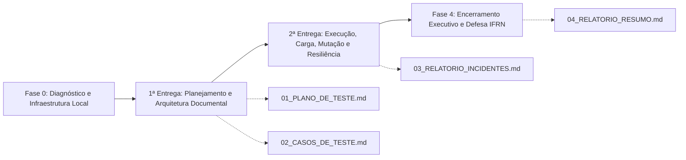
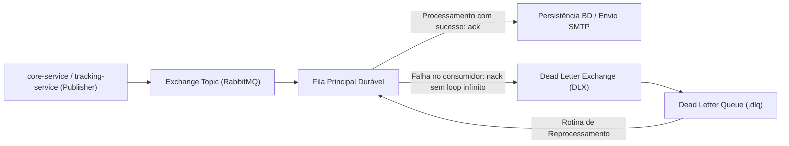

# Roteiro Mestre de Ação em Qualidade e Teste de Software — SIF (Frota-Fácil)

**Instituição:** Instituto Federal de Educação, Ciência e Tecnologia do Rio Grande do Norte (IFRN) — *Campus Pau dos Ferros*  
**Componente / Escopo:** Projeto Integrador de Desenvolvimento de Sistemas Corporativos — *Teste de Software*  
**Sistema Sob Teste (SUT):** **SIF — Sistema Integrado de Frotas** (`https://github.com/Frota-Facil`)  
**Versão do Documento:** 1.0 (Português — Referência oficial alinhada às diretrizes acadêmicas do IFRN)  
**Status de Alocação:** **Sem responsável atribuído** *(Todas as tarefas mantêm o campo `Responsável: [A definir]` para distribuição formal pela equipe)*

---

## Objetivo e Escopo deste Roteiro

Este documento consolida e desdobra integralmente todos os requisitos acadêmicos e corporativos estabelecidos em:
1. **`projeto_integrador_teste_de_software.md`** (*1ª Entrega: Planejamento e Arquitetura de Testes* e *2ª Entrega: Execução, Qualidade, Carga e Resiliência*).
2. **`modelo_de_plano_de_teste.md`** (*Plano de Teste*, *Casos de Teste*, *Relatório de Incidente* e *Relatório de Resumo de Teste*).

Cada exigência metodológica foi cruzada com uma **auditoria técnica real nos repositórios locais** da organização `Frota-Facil`, transformando os critérios avaliativos do IFRN em tarefas práticas, rastreáveis e organizadas em fases cronológicas sem pré-atribuição de responsáveis.

---

## Fase 0: Diagnóstico e Infraestrutura Local do Ecossistema SIF

### 0.1 Diagnóstico Atual dos Repositórios, Dependências e Suítes de Teste

A inspeção direta do diretório local (`FlotaFacil/`) estabelece a seguinte linha de base técnica:

| Componente / Repositório | Stack Tecnológica | Porta Local | Status de Clonagem e Build | Situação Atual de Testes e CI |
| :--- | :--- | :--- | :--- | :--- |
| **`admin-app`** | Next.js 16.2, React 19, TypeScript 5, Zod 4, Biome | `3000` | Clonado, dependências instaladas, corrigido e funcional (`npm.cmd run dev` / `build`) | Sem framework E2E (Playwright/Cypress) ou testes unitários configurados; sem workflow CI. |
| **`core-service`** | Node.js, Fastify 5, Drizzle ORM, Zod 4, `amqplib`, `prom-client`, Biome | `3333` | Clonado, operacional via Docker (`app-dev`), migrações e `seed` aplicados | Possui **Vitest 4.1** e `tests/use-cases.spec.ts` (unitários com mocks) + workflow `.github/workflows/core-ci.yml`. Ausência de `@vitest/coverage-v8`, testes de integração reais, DLQ e Stryker. |
| **`notification-service`** | Node.js, Fastify 5, TypeScript, `amqplib`, Nodemailer, `prom-client` | `3331` | Clonado, `compose.yml` configurado em conjunto com MailHog | Sem executor de testes (`vitest`), sem linter, sem workflow CI e **sem DLQ configurada** (`nack` comentado em `notification-consumer.ts`). |
| **`tracking-service`** | Go 1.23, `amqp091-go`, `prometheus/client_golang` | `8080` | Clonado, `docker-compose.yml` operacional com hot-reload Air | Possui `internal/server/server_test.go` (`go test`). Pendente geração formal de `-coverprofile` e workflow CI. |
| **`ai-service`** | Python, FastAPI 0.136, Pydantic v2, OpenAI SDK, Uvicorn | `8001` | Clonado, `compose.yml` e `.env` configurados | Sem `pytest` / `pytest-cov` no `requirements.txt`, sem endpoint `/metrics` ativo e sem workflow CI. |
| **`App-client`** | React Native / Expo (Aplicativo móvel do motorista) | Metro / Expo | Clonado (`App-client/Frontend`) | Fora do escopo primário de automação E2E web; referência complementar para fluxos de viagem e GPS. |
| **`observability`** | Prometheus + Grafana (4 painéis provisionados na pasta `SIF`) | `9090` / `3001` | Clonado (`observability/docker-compose.yml`) | **Divergência de portas identificada:** `prometheus.yml` aponta para `3334` (`tracking`) e `3335` (`notification`), enquanto os respectivos `compose` expõem `8080` e `3331`. |
| **`documentation`** | Artefatos PDF/PNG de requisitos, arquitetura C4, classes e banco | N/A | Clonado (Casos de Uso, Requisitos, Diagramas e Modelo Lógico) | Base documental oficial para derivação dos Casos de Teste Iniciais da 1ª Entrega. |

### 0.2 Verificação dos Contêineres de Suporte (Docker Compose)

| Contêiner / Serviço | Arquivo Compose de Origem | Porta(s) no Host | Credenciais Locais | Status / Observação Técnica |
| :--- | :--- | :--- | :--- | :--- |
| **PostgreSQL 16 (`postgres-dev`)** | `core-service/compose.dev.yml` | `5431 -> 5432` | `postgres-dev` / `postgres-dev` (BD: `sif-dev`) | Operacional com `healthcheck` (`pg_isready`). |
| **RabbitMQ 3.13 (`rabbitmq-dev`)** | `core-service/compose.dev.yml` | `5672` (AMQP), `15672` (UI) | `admin` / `admin` | Operacional com painel web Management habilitado. |
| **MinIO / Silo S3 (`minio-dev`)** | `core-service/compose.dev.yml` | `9000` (API S3), `9001` (UI) | `minioadmin` / `minioadmin` | Atualizado para `pgsty/silo:latest` com bucket público `sif-dev` inicializado automaticamente. |
| **MailHog (`mailhog`)** | `notification-service/compose.yml` | `1025` (SMTP), `8025` (UI) | Sem autenticação | Captura local de e-mails transacionais de solicitações de veículos. |
| **Prometheus + Grafana** | `observability/docker-compose.yml` | `9090` / `3001` | Grafana: `admin` / `admin` | Requer alinhamento de portas dos *targets* antes da bateria de testes de carga. |

### 0.3 Tarefas de Nivelamento de Diagnóstico e Infraestrutura Local

- [x] **T0.1 — Validação completa de inicialização dos contêineres e integridade do ambiente**  
  - **Responsável:** `[A definir]`  
  - **Descrição:** Inicializar sequencialmente `core-service/compose.dev.yml`, `notification-service/compose.yml`, `tracking-service/docker-compose.yml`, `ai-service/compose.yml` e `observability/docker-compose.yml`. Confirmar o status `healthy`/`Up` de todos os serviços de suporte e validar o login administrativo no `admin-app` (`http://localhost:3000`) com a conta semente (`000.000.000-00` / `123456`).  
  - **Critério de Aceitação:** Registro de `docker ps` íntegro e autenticação funcional no painel administrativo.

- [x] **T0.2 — Execução e registro da linha de base (*baseline*) de testes existentes**  
  - **Responsável:** `[A definir]`  
  - **Descrição:** Executar as suítes já existentes nos repositórios: `npm.cmd run test` e `npm.cmd run lint` no `core-service`, `go test ./...` no `tracking-service` e `npm.cmd run lint` / `npm.cmd run build` no `admin-app`. Documentar a quantidade inicial de testes e o tempo de execução.  
  - **Critério de Aceitação:** Relatório quantitativo inicial registrado para comparação evolutiva na 2ª Entrega.

- [x] **T0.3 — Alinhamento das portas de coleta de métricas no Prometheus/Grafana (`/metrics`)**  
  - **Responsável:** `[A definir]`  
  - **Descrição:** Corrigir a divergência entre `observability/prometheus/prometheus.yml` (configurado para `host.docker.internal:3334` no `tracking-service` e `3335` no `notification-service`) e as portas efetivamente expostas nos arquivos `docker-compose` (`8080` e `3331`), garantindo que os 3 *targets* (`core-service`, `tracking-service` e `notification-service`) fiquem com status **`UP`** em `http://localhost:9090/targets`.  
  - **Critério de Aceitação:** Todos os *targets* ativos no Prometheus e populando corretamente os dashboards `SIF` no Grafana (`http://localhost:3001`).

- [x] **T0.4 — Mapeamento arquitetural das filas RabbitMQ e diagnóstico de ausência de DLQ**  
  - **Responsável:** `[A definir]`  
  - **Descrição:** Documentar a topologia atual de mensageria: exchanges `events` e `tracking` (tipo `topic`, duráveis) e filas `notification.solicitation.created` e `tracking.coordinates.updated`. Registrar tecnicamente a ausência atual de parâmetros `x-dead-letter-exchange` (DLX) e de filas `.dlq`, subsidiando a especificação da 1ª Entrega e a implementação de resiliência da 2ª Entrega.  
  - **Critério de Aceitação:** Diagrama comparativo da topologia atual versus topologia resiliente com DLQ.

---

## 1ª Entrega Academicamente Requerida: Planejamento e Arquitetura de Testes

> **Natureza da 1ª Entrega (conforme `projeto_integrador_teste_de_software.md`):** Estritamente **documental e metodológica**, voltada ao design estratégico da qualidade, definição da Pirâmide de Testes, infraestrutura de CI, Critérios de Entrada e Saída e derivação inicial de casos de teste em conformidade com o **`modelo_de_plano_de_teste.md`**.  
> **Artefatos-alvo:** `01_PLANO_DE_TESTE.md` e `02_CASOS_DE_TESTE.md`.

### Bloco 1.1 — Escopo e Pirâmide de Testes

- [ ] **T1.1 — Delimitação formal do Escopo de Testes (*In-Scope* e *Out-of-Scope*)**  
  - **Responsável:** `[A definir]`  
  - **Descrição:** Especificar claramente em `01_PLANO_DE_TESTE.md` o que será testado e o que não fará parte do escopo nesta versão:
    - **Dentro do Escopo (*In-Scope*):**
      1. *Segurança, Autenticação e Controle de Acesso:* Autenticação por CPF e senha (`bcryptjs`), emissão e validação de tokens via `@fastify/jwt`, proteção de rotas e autorização baseada em papéis (`ADMIN` vs `DRIVER` via `verify-jwt.ts` e `authorize.ts`). *(Justificativa arquitetural explícita: documentar que o SIF adota autenticação JWT própria com RBAC no `core-service` e sessão protegida no `admin-app`, exercendo o papel de camada de identidade exemplificado como Keycloak no documento orientador).*
      2. *Regras de Negócio Críticas (`core-service`):* Gestão de Usuários (unicidade de CPF/e-mail, política de senha, perfis), Gestão de Veículos (unicidade de placa, disponibilidade, upload via URL pré-assinada S3/MinIO), Solicitações de Frota (criação, verificação de conflito de agenda por veículo/motorista, aprovação e rejeição), Ciclo de Vida de Rotas/Viagens (início, registro de coordenadas, encerramento e atualização transacional de status) e Logs de Auditoria.
      3. *Fluxos de Mensageria Assíncrona (RabbitMQ):* Publicação e consumo nas filas `notification.solicitation.created` (`core-service` -> `notification-service` -> MailHog) e `tracking.coordinates.updated` (`tracking-service` -> `core-service` -> PostgreSQL), contemplando tratamento de falhas e *Dead Letter Queue* (DLQ).
      4. *Integração com Microsserviços Auxiliares e Interface Web (`admin-app`):* Geração de relatórios gerenciais/rotas com `ai-service` (com *mock* determinístico da OpenAI em CI) e fluxos críticos de interface administrativa no `admin-app`.
    - **Fora do Escopo (*Out-of-Scope*):** Automação E2E em dispositivos móveis físicos do aplicativo `App-client` (Expo), testes intrusivos de invasão (*pentest*) de terceiros, consumo tarifado em larga escala da API externa da OpenAI e disponibilidade externa do provedor LocationIQ.
  - **Critério de Aceitação:** Seção de escopo redigida com precisão técnica e aderência total à arquitetura real do SIF.

- [ ] **T1.2 — Definição e justificativa técnica da Pirâmide de Testes adotada**  
  - **Responsável:** `[A definir]`  
  - **Descrição:** Apresentar a proporção planejada pela equipe e justificá-la com base na arquitetura distribuída de microsserviços do SIF:
    - **Base — Testes Unitários (~70%):** Execução rápida e isolada sobre casos de uso (`core-service/src/use-cases/**`), contratos Zod (`src/contracts/**`), utilitários e máscaras (`admin-app/src/utils/**`), formatação de notificações (`notification-service`), *handlers* HTTP em Go (`tracking-service`) e regras de relatório em Python (`ai-service`).
    - **Camada Intermediária — Testes de Integração, Contratos e Mensageria (~20%):** Validação com infraestrutura conteinerizada via Docker Compose (PostgreSQL `sif-dev`, RabbitMQ, MinIO/Silo e MailHog), cobrindo repositórios Drizzle, rotas Fastify (`app.inject`), publicação/consumo de eventos AMQP e redirecionamento para DLQ.
    - **Topo — Testes de Sistema / Ponta a Ponta UI (~10%):** Suíte enxuta focada nas jornadas críticas de negócio no navegador através do `admin-app` integrado ao backend, reduzindo custo de manutenção e *flakiness*.
  - **Critério de Aceitação:** Representação visual em Mermaid acompanhada de fundamentação arquitetural sólida.

### Bloco 1.2 — Ferramentas, Infraestrutura de Teste e Integração Contínua (CI)

- [ ] **T1.3 — Especificação da Stack Tecnológica de Testes por Nível e Microsserviço**  
  - **Responsável:** `[A definir]`  
  - **Descrição:** Listar e justificar o ferramental escolhido para o ecossistema poliglota do SIF:
    - **Unitários e Integração TypeScript (`core-service`, `notification-service`, `admin-app`):** `Vitest` + `@vitest/coverage-v8` + `Fastify Inject`.
    - **Unitários e Integração Python (`ai-service`):** `Pytest` + `pytest-cov` + `httpx` (`TestClient`).
    - **Unitários e Integração Go (`tracking-service`):** `go test` nativo + `net/http/httptest` + `-coverprofile`.
    - **Sistema / E2E Web (`admin-app`):** `Playwright` (suporte moderno ao Next.js 16, execução *headless* em CI, gravação de vídeo/trace e asserções auto-aguardáveis).
    - **Testes de Carga e Desempenho:** `k6` (integração nativa com métricas de percentil `p95`/`p99` e correlação com Prometheus/Grafana).
    - **Testes de Mutação (2ª Entrega):** `StrykerJS` (`@stryker-mutator/core` + `@stryker-mutator/vitest-runner`) aplicado à suíte do `core-service`.
    - **Análise Estática e Padronização:** `Biome`, `tsc --noEmit`, `go vet` e `Ruff`.
  - **Critério de Aceitação:** Matriz completa relacionando Nível da Pirâmide, Microsserviço, Linguagem e Ferramenta.

- [ ] **T1.4 — Documentação e Arquitetura do Pipeline de Integração Contínua (GitHub Actions)**  
  - **Responsável:** `[A definir]`  
  - **Descrição:** Explicar detalhadamente como o pipeline existente em `core-service/.github/workflows/core-ci.yml` dispara validações automáticas a cada `push` ou `Pull Request` nas branches `main` e `develop` (checkout, Node.js `22.14` com cache npm, `npm ci`, `npm run test`, `npm run build` e `npm run lint`), bem como especificar sua expansão padronizada para os demais microsserviços (`admin-app`, `notification-service`, `tracking-service` e `ai-service`) com *service containers* (PostgreSQL e RabbitMQ).  
  - **Critério de Aceitação:** Fluxograma do pipeline CI e explicação técnica documentados em `01_PLANO_DE_TESTE.md`.

### Bloco 1.3 — Critérios de Entrada (*Entry Criteria*) e de Saída (*Exit Criteria*)

- [ ] **T1.5 — Definição formal de Critérios de Entrada e Saída para Testes Unitários**  
  - **Responsável:** `[A definir]`  
  - **Descrição:** Formalizar as condições objetivas:
    - *Critérios de Entrada:* Código da funcionalidade commitado na branch de desenvolvimento (`develop`/feature); projeto compilando sem erros; pipeline base configurado e operacional.
    - *Critérios de Saída:* **100%** dos testes unitários passando; **cobertura de código (*code coverage*) mínima >= 80%** estipulada pela equipe sobre a camada de regras de negócio (`use-cases`); ausência de erros na análise estática (`biome check`).
  - **Critério de Aceitação:** Seção 3.1 redigida com metas métricas claras e auditáveis.

- [ ] **T1.6 — Definição formal de Critérios de Entrada e Saída para Integração e Mensageria (Filas e Broker)**  
  - **Responsável:** `[A definir]`  
  - **Descrição:** Formalizar as condições objetivas:
    - *Critérios de Entrada:* Ambientes de infraestrutura inicializados e saudáveis via Docker Compose (`postgres-dev`, `rabbitmq-dev`, `minio-dev`, `mailhog`); migrações do banco aplicadas; contratos de API HTTP (Zod) e payloads de eventos AMQP definidos.
    - *Critérios de Saída:* Cenários de publicação e consumo das filas `notification.solicitation.created` e `tracking.coordinates.updated` validados ponta a ponta, com evidências formais do tratamento de falhas no consumidor e redirecionamento seguro para a **Dead Letter Queue (DLQ)**.
  - **Critério de Aceitação:** Seção 3.2 integralmente aderente ao edital do Projeto Integrador.

- [ ] **T1.7 — Definição formal de Critérios de Entrada e Saída para Testes de Carga e Desempenho (Planejamento)**  
  - **Responsável:** `[A definir]`  
  - **Descrição:** Formalizar as condições objetivas:
    - *Critérios de Entrada:* Endpoints críticos mapeados (ex.: `POST /auth/login`, `GET /vehicles/available`, `POST /requests/me`, `POST /tracking`); parâmetros de estresse e volumetria definidos (usuários simultâneos, rampa de subida, tempo de sustentação e SLAs como `p95 < 500ms` e taxa de erro `< 1%`).
    - *Critérios de Saída:* Cenários e scripts de teste de carga em `k6` estruturados, versionados e prontos para execução comparativa na fase final (2ª Entrega).
  - **Critério de Aceitação:** Seção 3.3 documentada com tabela de volumetria e metas de desempenho.

### Bloco 1.4 — Consolidação do Plano Institucional e Casos de Teste Iniciais

- [ ] **T1.8 — Estruturação completa do arquivo `01_PLANO_DE_TESTE.md` segundo o Modelo Institucional**  
  - **Responsável:** `[A definir]`  
  - **Descrição:** Integrar os tópicos corporativos do Projeto Integrador com **todos os campos obrigatórios do `modelo_de_plano_de_teste.md`**:
    1. *Nome do Projeto* (`SIF — Sistema Integrado de Frotas`).
    2. *Pessoas Envolvidas / Responsabilidade* (quadro estruturado por papéis de teste sem nomes pré-fixados até deliberação da equipe).
    3. *Funcionalidades ou Módulos* (Autenticação/RBAC, Usuários, Veículos, Solicitações e Agendamento de Frota, Rotas e Rastreamento GPS, Notificações por E-mail/Push, Relatórios com IA e Logs de Auditoria).
    4. *Equipamentos / Softwares* (Ambiente Web/Browser, Docker Engine, contêineres de suporte e ferramentas de teste).
    5. *Cronograma* (Datas de início e término do projeto e das janelas de teste da 1ª e 2ª Entrega).
    6. *Local dos Testes* (Estações locais padronizadas via Docker das pessoas envolvidas, runners do GitHub Actions e ambiente de Produção/Staging).
    7. *Critério para considerar o teste finalizado* (Preenchimento da coluna de resultado como *"Executado com sucesso"* aliado ao cumprimento integral dos *Exit Criteria* técnicos).
    8. *Observações* (Política de comunicação de incidentes aos desenvolvedores e geração encadeada dos artefatos de casos, incidentes e resumo).
  - **Critério de Aceitação:** Documento `01_PLANO_DE_TESTE.md` finalizado e aderente aos dois documentos norteadores.

- [ ] **T1.9 — Mapeamento de Requisitos e Histórias de Usuário a partir de `documentation/`**  
  - **Responsável:** `[A definir]`  
  - **Descrição:** Analisar `documentation/Documentos de Requisitos - SIF.pdf`, `Casos de Uso - SIF.pdf` e os esquemas Zod de `core-service/src/contracts/` e `admin-app/src/server/contracts/` para extrair regras de validação, pré-condições e fluxos alternativos/exceções.  
  - **Critério de Aceitação:** Lista rastreável de histórias de usuário e regras de negócio priorizadas.

- [ ] **T1.10 — Elaboração da Tabela Inicial de Casos de Teste em `02_CASOS_DE_TESTE.md`**  
  - **Responsável:** `[A definir]`  
  - **Descrição:** Construir uma matriz inicial robusta (**30 a 40 casos de teste**) cobrindo todos os módulos críticos do SIF e unificando as colunas exigidas pelo edital e pelo modelo de plano de teste:  
    `ID | Módulo | Requisito/US | Descrição | Pré-condições | Roteiro (Passos de Execução) | Resultado Esperado | Resultado do Desenvolvedor | Resultado do Teste`  
    *(Na 1ª Entrega, as colunas de execução permanecem identificadas como `Aguardando execução — 2ª Entrega`, respeitando o escopo estritamente planejado e documental da etapa).*  
    Contemplar validações de campos obrigatórios em branco, limites de caracteres de senha, validação de CPF e e-mail, unicidade de placa, bloqueio de conflito de horário na aprovação de solicitações, autorização por perfil, início/encerramento de rotas, emissão de relatório IA e publicação em fila.
  - **Critério de Aceitação:** Arquivo `02_CASOS_DE_TESTE.md` estruturado, rastreável e fiel às telas e rotas reais do SIF.

---

## 2ª Entrega Academicamente Requerida: Execução, Qualidade, Carga e Resiliência

> **Natureza da 2ª Entrega (conforme `projeto_integrador_teste_de_software.md`):** Sistema em pleno funcionamento em ambiente de Produção/Staging. A avaliação mensura na prática a **eficácia da automação, relatórios de cobertura, testes E2E web, resiliência de mensageria RabbitMQ (DLQ e reprocessamento), escalabilidade horizontal (`1` vs `N` instâncias) correlacionada no Grafana, teste de mutação, teste de regressão com análise formal de falhas e pipeline de CI/CD completo**.  
> **Artefatos-alvo:** Preenchimento de execução em `02_CASOS_DE_TESTE.md`, geração de `03_RELATORIO_INCIDENTES.md` e consolidação em `04_RELATORIO_RESUMO.md`.

### Bloco 2.1 — Execução da Pirâmide de Testes e Cobertura

- [ ] **T2.1 — Instrumentação de Cobertura e Expansão de Testes Unitários em `core-service` e `notification-service`**  
  - **Responsável:** `[A definir]`  
  - **Descrição:** Instalar `@vitest/coverage-v8` no `core-service`, configurar o script `"test:coverage": "vitest run --coverage"`, expandir os testes em `tests/` para cobrir integralmente os casos de uso críticos e configurar o `Vitest` no `notification-service` para validar a montagem de e-mails e o tratamento de eventos da fila.  
  - **Critério de Aceitação:** Relatórios oficiais de cobertura gerados comprovando índice `>= 80%` nas regras de negócio com `100%` dos testes aprovados.

- [ ] **T2.2 — Implementação de Suíte Automatizada e Cobertura em `ai-service` (Python) e `tracking-service` (Go)**  
  - **Responsável:** `[A definir]`  
  - **Descrição:** Adicionar `pytest`, `pytest-cov` e `pytest-asyncio` ao `ai-service` testando validação Pydantic, rotas `report_routes.py`, tratamento de erros e serviço de integração IA mockado. No `tracking-service`, ampliar os testes dos pacotes `handlers` e `server` executando `go test -v -coverprofile=coverage.out ./...` e extraindo métricas percentuais com `go tool cover`.  
  - **Critério de Aceitação:** Relatórios gerados pelo `Pytest` e pelo `go test` anexados ao dossiê de qualidade.

- [ ] **T2.3 — Implementação de Testes de Integração HTTP e Persistência (`core-service`)**  
  - **Responsável:** `[A definir]`  
  - **Descrição:** Criar suíte de integração utilizando `fastify.inject()` conectada a banco PostgreSQL de teste e S3/MinIO, validando autenticação JWT, persistência real via Drizzle ORM, regras transacionais de aprovação/conflito de agenda e geração de URLs pré-assinadas.  
  - **Critério de Aceitação:** Suíte de integração automatizada passando sem dependência de passos manuais.

- [ ] **T2.4 — Automação de Testes de Sistema / E2E com Playwright apontando para Produção/Staging**  
  - **Responsável:** `[A definir]`  
  - **Descrição:** Configurar `Playwright` no `admin-app` parametrizado para apontar para a **URL de Produção/Staging** (e `http://localhost:3000` em validação local), automatizando a demonstração prática dos fluxos críticos de negócio:
    1. Login administrativo (credenciais válidas e tratamento de erro para credenciais inválidas).
    2. Cadastro, validação de formulário e edição de Usuários/Motoristas.
    3. Registro, listagem e consulta de detalhes de Veículos.
    4. Fluxo completo de Solicitações de Frota (análise de pendentes, aprovação/rejeição e auditoria em Logs).
    5. Visualização de Rotas, Monitoramento e abertura de Relatório de Rota.
  - **Critério de Aceitação:** Execução E2E gravada/evidenciada na URL publicada com relatório HTML do Playwright.

### Bloco 2.2 — Validação de Resiliência e Arquitetura Distribuída

- [ ] **T2.5 — Implementação de Dead Letter Queue (DLQ) e Mecanismo de Reprocessamento no RabbitMQ**  
  - **Responsável:** `[A definir]`  
  - **Descrição:** Refatorar a configuração de mensageria no `notification-service` e no `core-service` para declarar formalmente uma *Dead Letter Exchange* (`sif.dlx`) e as filas mortas correspondentes (`notification.solicitation.created.dlq` e `tracking.coordinates.updated.dlq`) via `x-dead-letter-exchange` e `x-dead-letter-routing-key`. Ajustar os consumidores para rejeitar mensagens defeituosas/falhas (`channel.nack(msg, false, false)` após política de tentativas) e implementar mecanismo automatizado/controlado de **reprocessamento (*requeue/redrive*)** a partir da DLQ.  
  - **Critério de Aceitação:** Filas `.dlq` provisionadas no RabbitMQ e rotina de reprocessamento validada.

- [ ] **T2.6 — Simulação Prática de Falha no Consumidor e Evidência de Retenção/Reprocessamento via DLQ**  
  - **Responsável:** `[A definir]`  
  - **Descrição:** Simular uma falha real no consumidor da fila (ex.: indisponibilidade induzida do servidor SMTP `mailhog` ou falha forçada no consumidor), disparar eventos pelo sistema e coletar evidências comprovando: (1) o comportamento resiliente do sistema sem queda global, (2) o redirecionamento e retenção segura da mensagem na **DLQ** no painel do RabbitMQ (`http://localhost:15672`), e (3) o posterior reprocessamento bem-sucedido após normalização do serviço consumidor.  
  - **Critério de Aceitação:** Relatório passo a passo com capturas de tela do broker, logs de erro/recuperação e confirmação de entrega final.

- [ ] **T2.7 — Execução de Testes de Estresse e Carga (`k6` / `Locust`)**  
  - **Responsável:** `[A definir]`  
  - **Descrição:** Executar baterias de estresse progressivo utilizando `k6` sobre os endpoints críticos do microsserviço avaliado (`core-service` e/ou `tracking-service`), coletando vazão (RPS), tempos de resposta (`avg`, `p90`, `p95`, `p99`) e taxa de erros sob alta concorrência.  
  - **Critério de Aceitação:** Scripts versionados e relatórios brutos/gráficos exportados pelo `k6`.

- [ ] **T2.8 — Comparativo Prático `1` Instância vs. `N` Instâncias e Análise de Gargalo no Grafana**  
  - **Responsável:** `[A definir]`  
  - **Descrição:** Configurar balanceamento reverso (ex.: `Nginx` ou `Traefik`) para submeter exatamente a mesma carga de estresse a dois cenários:
    1. **Cenário 1:** Execução com **`1` instância** do microsserviço.
    2. **Cenário 2:** Execução escalada horizontalmente com **`N` instâncias** (ex.: `3` réplicas via Docker Compose/orquestrador).
    Utilizar os painéis do **Grafana** (`observability/`, `http://localhost:3001`) para correlacionar o uso de **CPU, memória RAM e latência**, identificar tecnicamente o **gargalo encontrado** (ex.: custo computacional de CPU no hash `bcryptjs`, saturação do pool de conexões do PostgreSQL ou contenção de I/O) e fundamentar a explicação arquitetural.
  - **Critério de Aceitação:** Tabela comparativa direta `1` vs `N` instâncias + prints comentados dos painéis do Grafana + diagnóstico técnico do gargalo.

### Bloco 2.3 — Métricas Avançadas de Qualidade

- [ ] **T2.9 — Aplicação de Teste de Mutação e Defesa Técnica do Escore de Mutação**  
  - **Responsável:** `[A definir]`  
  - **Descrição:** Configurar e executar o `StrykerJS` na suíte de testes unitários do `core-service` (`src/use-cases/**`). Inspecionar os mutantes sobreviventes, aprimorar os casos de teste cujas asserções mostraram baixa sensibilidade e elaborar a defesa técnica do **Escore de Mutação** obtido, demonstrando a eficácia real da suíte além da simples cobertura de linhas.  
  - **Critério de Aceitação:** Relatório HTML do Stryker gerado e análise crítica do escore obtido documentada.

- [ ] **T2.10 — Teste de Regressão com Quebra Proposital e Relatório Formal de Métricas de Falha**  
  - **Responsável:** `[A definir]`  
  - **Descrição:** Em branch isolada de experimento, efetuar propositalmente uma alteração/quebra em uma regra de negócio existente do sistema (ex.: remoção da checagem de conflito de agenda na aprovação de solicitação ou inversão de validação de permissão/status). Executar a suíte de regressão automatizada completa e reportar formalmente as métricas exigidas pelo IFRN:
    - Quantidade total de casos de teste na suíte ($T$).
    - Quantos casos de teste falharam ($F$)?
    - Qual foi a porcentagem exata de falhas em relação ao total da suíte ($(F / T) \times 100\%$)?
    Reverter a quebra proposital após a coleta das evidências e confirmar o retorno da suíte a `100%` de aprovação.
  - **Critério de Aceitação:** Logs comprobatórios da execução quebrada, cálculo percentual formal apresentado e restauração limpa do código.

### Bloco 2.4 — Governança, CI/CD Consolidado e Documentação de Encerramento

- [ ] **T2.11 — Consolidação do Pipeline Completo de CI/CD no GitHub Actions**  
  - **Responsável:** `[A definir]`  
  - **Descrição:** Consolidar o pipeline automatizado em pleno funcionamento contemplando todas as etapas exigidas na 2ª Entrega:
    1. *Build* completo da aplicação.
    2. *Análise Estática de Código* (`biome check`, verificação de tipos, `go vet`, `ruff`).
    3. *Execução da Suíte Completa de Testes* (unitários, integração e geração de artefatos de cobertura).
    4. *Deploy Final Automatizado* para o ambiente de Produção/Staging mediante aprovação nos *Quality Gates*.
  - **Critério de Aceitação:** Execução íntegra e comprovada por histórico público/capturas das *Actions* no GitHub.

- [ ] **T2.12 — Elaboração do Relatório de Incidentes em `03_RELATORIO_INCIDENTES.md`**  
  - **Responsável:** `[A definir]`  
  - **Descrição:** Registrar formalmente todas as falhas e não conformidades identificadas antes e durante as baterias de teste (incluindo correções aplicadas no `admin-app`, ajustes de infraestrutura S3/variáveis de ambiente, divergência de portas na stack de observabilidade, ausência inicial de DLQ no consumidor de notificações e incidentes funcionais detectados na execução dos casos de teste), seguindo fielmente a tabela do **`modelo_de_plano_de_teste.md`**:  
    `ID | Status | Responsável pela correção | Prioridade de correção | Descrição do erro | Data e Nome de quem corrigiu`  
  - **Critério de Aceitação:** Documento `03_RELATORIO_INCIDENTES.md` completo e rastreado aos casos de teste correspondentes.

---

## Fase 4: Encerramento, Relatório Resumo e Exposição / Defesa Acadêmica

- [ ] **T3.1 — Consolidação do Relatório de Resumo de Teste e Qualidade Executiva em `04_RELATORIO_RESUMO.md`**  
  - **Responsável:** `[A definir]`  
  - **Descrição:** Elaborar o documento final unificando:
    1. **Estrutura integral do `modelo_de_plano_de_teste.md`:** Nome do Projeto, Data de início e fim dos testes, Descrição analítica sobre a detecção e ciclo de correção de defeitos, Pessoas envolvidas, **Tabela de Números dos Testes** (*criados antes, criados durante, executados, com sucesso, com erro, enviados para correção*) e **Tabela de Percentuais** (*% executados, % executados com sucesso, % com incidência de erro, % corrigidos pelo desenvolvedor*).
    2. **Resumo Executivo Consolidado da Qualidade (2ª Entrega IFRN):** Panorama executivo de cobertura alcançada por microsserviço, resultados E2E na URL de produção, validação de resiliência RabbitMQ/DLQ, síntese do experimento `1` vs `N` instâncias no Grafana, defesa do Escore de Mutação, métricas do teste de regressão e governança de CI/CD.
  - **Critério de Aceitação:** Arquivo `04_RELATORIO_RESUMO.md` matematicamente consistente com `02_CASOS_DE_TESTE.md` e `03_RELATORIO_INCIDENTES.md`.

- [ ] **T3.2 — Elaboração do Roteiro Técnico de Apresentação com Diagramas Mermaid para a Defesa**  
  - **Responsável:** `[A definir]`  
  - **Descrição:** Estruturar o roteiro de defesa oral perante a banca avaliadora do IFRN (*Campus Pau dos Ferros*), incorporando diagramas **Mermaid** explicativos (Arquitetura de Microsserviços do SIF, Pirâmide de Testes, Fluxo de Resiliência com DLQ e Reprocessamento, Arquitetura de Monitoramento e Escalabilidade `1` vs `N`, e Pipeline CI/CD) e sequência cronológica para demonstração prática ao vivo.  
  - **Critério de Aceitação:** Roteiro de defesa revisado, com checklist de demonstração ao vivo e pacote de evidências de contingência.

---

## Matriz Mestre de Rastreabilidade (Requisitos IFRN x Tarefas x Artefatos)

| Documento de Origem | Seção / Requisito Avaliativo | Tarefas Vinculadas | Artefato Final (`.md`) |
| :--- | :--- | :--- | :--- |
| **Diretriz SIF Auditor** | Diagnóstico dos microsserviços e contêineres Docker Compose | `T0.1`, `T0.2`, `T0.3`, `T0.4` | `00_ROADMAP_ACAO.md` / `01_PLANO_DE_TESTE.md` |
| **1ª Entrega — Item 1** | Delimitação do Escopo e Pirâmide de Testes justificada | `T1.1`, `T1.2` | `01_PLANO_DE_TESTE.md` |
| **1ª Entrega — Item 2** | Stack Tecnológica de Testes e Integração Contínua (GitHub Actions) | `T1.3`, `T1.4` | `01_PLANO_DE_TESTE.md` |
| **1ª Entrega — Item 3** | *Entry* e *Exit Criteria* (Unitários, Integração/Filas/DLQ e Carga) | `T1.5`, `T1.6`, `T1.7` | `01_PLANO_DE_TESTE.md` |
| **Modelo Plano de Teste** | Seções formais do Plano (Equipe, Módulos, Softwares, Cronograma, Local, Fim) | `T1.8` | `01_PLANO_DE_TESTE.md` |
| **1ª Entrega — Item 4 + Modelo** | Casos de Teste Iniciais derivados das Histórias de Usuário | `T1.9`, `T1.10` | `02_CASOS_DE_TESTE.md` |
| **2ª Entrega — Item 1** | Relatórios de Cobertura e Testes de Sistema / E2E na URL de Produção | `T2.1`, `T2.2`, `T2.3`, `T2.4` | `02_CASOS_DE_TESTE.md` / `04_RELATORIO_RESUMO.md` |
| **2ª Entrega — Item 2.1** | Testes de Mensageria: falha no consumidor, retenção na DLQ e reprocessamento | `T2.5`, `T2.6` | `03_RELATORIO_INCIDENTES.md` / `04_RELATORIO_RESUMO.md` |
| **2ª Entrega — Item 2.2** | Testes de Carga (k6/Locust), comparativo `1` vs `N` instâncias e gargalo no Grafana | `T2.7`, `T2.8` | `04_RELATORIO_RESUMO.md` |
| **2ª Entrega — Item 3.1** | Teste de Mutação e defesa do escore de mutação obtido | `T2.9` | `04_RELATORIO_RESUMO.md` |
| **2ª Entrega — Item 3.2** | Teste de Regressão com quebra proposital (quantidade e % de falhas) | `T2.10` | `04_RELATORIO_RESUMO.md` |
| **2ª Entrega — Item 4.1** | Pipeline completo de CI/CD (Build + Análise Estática + Testes + Deploy) | `T2.11` | `04_RELATORIO_RESUMO.md` |
| **2ª Entrega — Item 4.2 + Modelo** | Relatório de Incidentes, Resumo Executivo Consolidado e Defesa Final | `T2.12`, `T3.1`, `T3.2` | `03_RELATORIO_INCIDENTES.md` / `04_RELATORIO_RESUMO.md` |

---

## Sequência Operacional Recomendada (Passo 4 — Próximas Etapas)

1. **Alinhamento e Divisão de Tarefas na Equipe:** Revisar este roteiro em reunião, alocar os códigos `T0.x` a `T3.x` substituindo `[A definir]` pelos respectivos responsáveis e validar o planejamento com o professor orientador.
2. **Fechamento da 1ª Entrega (Documental):** Produzir e revisar `01_PLANO_DE_TESTE.md` e `02_CASOS_DE_TESTE.md`.
3. **Execução Técnica da 2ª Entrega:** Alinhar coleta `/metrics` (`T0.3`), implementar DLQ e reprocessamento (`T2.5`–`T2.6`), expandir cobertura unitária/integração e E2E Playwright (`T2.1`–`T2.4`), rodar carga `1` vs `N` instâncias monitorada no Grafana (`T2.7`–`T2.8`), aplicar mutação com Stryker e ensaio de regressão (`T2.9`–`T2.10`) e consolidar CI/CD (`T2.11`).
4. **Encerramento e Apresentação:** Gerar `03_RELATORIO_INCIDENTES.md`, `04_RELATORIO_RESUMO.md` e o roteiro final de defesa com diagramas Mermaid (`T3.1`–`T3.2`).

