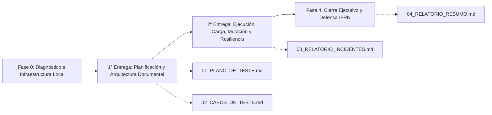
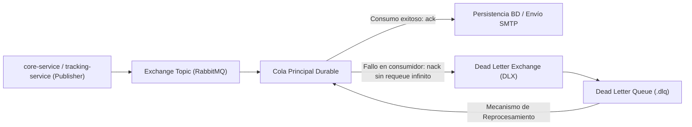

# Hoja de Ruta Maestra de Calidad y Pruebas de Software — SIF (Frota-Fácil)

**Institución:** Instituto Federal de Educação, Ciência e Tecnologia do Rio Grande do Norte (IFRN) — *Campus Pau dos Ferros*  
**Asignatura / Marco:** Projeto Integrador de Desenvolvimento de Sistemas Corporativos — *Teste de Software*  
**Sistema Bajo Prueba (SUT):** **SIF — Sistema Integrado de Frotas** (`https://github.com/Frota-Facil`)  
**Versión del Documento:** 1.0 (Español — Estudio interno, planificación técnica y reparto de tareas en equipo)  
**Estado de Asignación:** **Sin asignar** *(Todas las tareas tienen el campo `Responsable: [Sin asignar]` para distribución consensuada del equipo)*

---

## Propósito y Alcance de este Documento

Esta Hoja de Ruta traduce de forma exhaustiva todos los requisitos exigidos en:
1. **`projeto_integrador_teste_de_software.md`** (*1ª Entrega: Planejamento e Arquitetura de Testes* y *2ª Entrega: Execução, Qualidade, Carga e Resiliência*).
2. **`modelo_de_plano_de_teste.md`** (*Plano de Teste*, *Casos de Teste*, *Relatório de Incidente* y *Relatório de Resumo de Teste*).

Cada requisito académico ha sido cruzado con una **auditoría real del código fuente local** de los repositorios clonados de `Frota-Facil`, convirtiendo las exigencias teóricas del IFRN en tareas de ingeniería concretas, verificables y ordenadas cronológicamente sin preasignar responsables.

---

## Fase 0: Diagnóstico e Infraestructura Local del Ecosistema SIF

### 0.1 Estado Actual de Clonación, Dependencias y Pruebas por Repositorio

La inspección directa del entorno local (`FlotaFacil/`) arroja la siguiente línea base real:

| Componente / Repositorio | Stack Tecnológico | Puerto Local | Estado de Clonación / Build | Estado Actual de Pruebas y CI |
| :--- | :--- | :--- | :--- | :--- |
| **`admin-app`** | Next.js 16.2, React 19, TypeScript 5, Zod 4, Biome | `3000` | Clonado, dependencias instaladas, reparado y operativo (`npm.cmd run dev` / `build`) | Sin framework E2E (Playwright/Cypress) ni tests unitarios; sin workflow CI. |
| **`core-service`** | Node.js, Fastify 5, Drizzle ORM, Zod 4, `amqplib`, `prom-client`, Biome | `3333` | Clonado, operativo en Docker (`app-dev`), migraciones y `seed` aplicados | Posee **Vitest 4.1** y `tests/use-cases.spec.ts` (unitarios con mocks) + workflow `.github/workflows/core-ci.yml`. Falta `@vitest/coverage-v8`, tests de integración real, DLQ y Stryker. |
| **`notification-service`** | Node.js, Fastify 5, TypeScript, `amqplib`, Nodemailer, `prom-client` | `3331` | Clonado, `compose.yml` configurado junto a MailHog | Sin runner de pruebas (`vitest`), sin linter, sin workflow CI y **sin DLQ configurada** (`nack` comentado en `notification-consumer.ts`). |
| **`tracking-service`** | Go 1.23, `amqp091-go`, `prometheus/client_golang` | `8080` | Clonado, `docker-compose.yml` operativo con hot-reload Air | Posee `internal/server/server_test.go` (`go test`). Falta reporte formal `-coverprofile` y workflow CI. |
| **`ai-service`** | Python, FastAPI 0.136, Pydantic v2, OpenAI SDK, Uvicorn | `8001` | Clonado, `compose.yml` y `.env` configurados | Sin `pytest` / `pytest-cov` en `requirements.txt`, sin endpoint `/metrics` activo y sin workflow CI. |
| **`App-client`** | React Native / Expo (App móvil de conductores) | Metro / Expo | Clonado (`App-client/Frontend`) | Fuera del foco E2E web principal; útil como referencia de flujos de conductor (viajes y GPS). |
| **`observability`** | Prometheus + Grafana (4 dashboards provisionados) | `9090` / `3001` | Clonado (`observability/docker-compose.yml`) | **Desfase de puertos detectado:** `prometheus.yml` apunta a `3334` (`tracking`) y `3335` (`notification`), mientras sus `compose` exponen `8080` y `3331`. |
| **`documentation`** | Artefactos PDF/PNG de ingeniería de requisitos y arquitectura | N/A | Clonado (Casos de Uso, Requisitos, Diagramas C4/Clases, Modelo Lógico) | Insumo base oficial para derivar los Casos de Prueba de la 1ª Entrega. |

### 0.2 Estado de Contenedores de Soporte (Docker Compose)

| Contenedor / Servicio | Archivo Compose Origen | Puerto(s) Host | Credenciales Locales | Estado / Observación Técnica |
| :--- | :--- | :--- | :--- | :--- |
| **PostgreSQL 16 (`postgres-dev`)** | `core-service/compose.dev.yml` | `5431 -> 5432` | `postgres-dev` / `postgres-dev` (BD: `sif-dev`) | Operativo con `healthcheck` (`pg_isready`). |
| **RabbitMQ 3.13 (`rabbitmq-dev`)** | `core-service/compose.dev.yml` | `5672` (AMQP), `15672` (UI) | `admin` / `admin` | Operativo con consola web Management habilitada. |
| **MinIO / Silo S3 (`minio-dev`)** | `core-service/compose.dev.yml` | `9000` (API S3), `9001` (UI) | `minioadmin` / `minioadmin` | Actualizado a `pgsty/silo:latest` con bucket público `sif-dev` autoinicializado. |
| **MailHog (`mailhog`)** | `notification-service/compose.yml` | `1025` (SMTP), `8025` (UI) | Sin autenticación | Captura local de correos transaccionales de solicitudes de flota. |
| **Prometheus + Grafana** | `observability/docker-compose.yml` | `9090` / `3001` | Grafana: `admin` / `admin` | Requiere alineación de puertos de *scraping* antes de las pruebas de carga. |

### 0.3 Tareas de Nivelación de Diagnóstico e Infraestructura Local

- [x] **T0.1 — Verificación integral de arranque multi-contenedor y salud del entorno**  
  - **Responsable:** `[Sin asignar]`  
  - **Descripción:** Levantar secuencialmente `core-service/compose.dev.yml`, `notification-service/compose.yml`, `tracking-service/docker-compose.yml`, `ai-service/compose.yml` y `observability/docker-compose.yml`. Verificar que todos los contenedores reporten estado `healthy`/`Up` y que `admin-app` (`http://localhost:3000`) autentique correctamente con el usuario semilla (`000.000.000-00` / `123456`).  
  - **Criterio de Aceptación:** Captura o registro de `docker ps` saludable y login exitoso en `admin-app`.

- [x] **T0.2 — Auditoría y ejecución de líneas base de pruebas existentes**  
  - **Responsable:** `[Sin asignar]`  
  - **Descripción:** Ejecutar las suites actualmente presentes en el código: `npm.cmd run test` y `npm.cmd run lint` dentro de `core-service`, `go test ./...` dentro de `tracking-service`, y `npm.cmd run lint` / `npm.cmd run build` dentro de `admin-app`. Documentar tiempos de ejecución y número inicial de tests existentes.  
  - **Criterio de Aceptación:** Registro cuantitativo del punto de partida (línea base) antes de iniciar la ampliación de cobertura.

- [x] **T0.3 — Alineación de puertos de telemetría Prometheus/Grafana (`/metrics`)**  
  - **Responsable:** `[Sin asignar]`  
  - **Descripción:** Corregir la discrepancia detectada entre `observability/prometheus/prometheus.yml` (que consulta `host.docker.internal:3334` para `tracking-service` y `3335` para `notification-service`) y los puertos reales expuestos en sus respectivos `docker-compose` (`8080` y `3331`), verificando que los 3 *targets* (`core-service`, `tracking-service`, `notification-service`) aparezcan en estado **`UP`** en `http://localhost:9090/targets`.  
  - **Criterio de Aceptación:** Todos los servicios instrumentados visibles en estado `UP` en Prometheus y reflejando métricas en los paneles `SIF` de Grafana (`http://localhost:3001`).

- [x] **T0.4 — Diagnóstico arquitectónico de colas RabbitMQ y brecha de DLQ**  
  - **Responsable:** `[Sin asignar]`  
  - **Descripción:** Documentar la topología actual de mensajería: exchanges `events` y `tracking` (`topic`, durables) y colas `notification.solicitation.created` y `tracking.coordinates.updated`. Registrar formalmente que ninguna de las dos colas declara aún `x-dead-letter-exchange` (DLX) ni cola `.dlq`, insumo clave para el diseño de la 1ª Entrega y la implementación de resiliencia de la 2ª Entrega.  
  - **Criterio de Aceptación:** Diagrama de topología actual vs. topología objetivo con DLQ validado técnicamente.

---

## 1ª Entrega Académicamente Requerida: Planificación y Arquitectura de Pruebas

> **Naturaleza de la 1ª Entrega (según `projeto_integrador_teste_de_software.md`):** Estrictamente **documental, estratégica y metodológica**, enfocada en el diseño formal de la calidad, la arquitectura de pruebas, los criterios de entrada/salida y la derivación inicial de casos de prueba alineados con **`modelo_de_plano_de_teste.md`**.  
> **Artefactos objetivo:** `01_PLANO_DE_TESTE.md` y `02_CASOS_DE_TESTE.md`.

### Bloque 1.1 — Delimitación del Alcance y Pirámide de Pruebas

- [ ] **T1.1 — Definición formal del Alcance de Pruebas (*In-Scope* y *Out-of-Scope*)**  
  - **Responsable:** `[Sin asignar]`  
  - **Descripción:** Redactar en `01_PLANO_DE_TESTE.md` qué funcionalidades y componentes entran en alcance y cuáles quedan excluidos en esta versión:
    - **En Alcance (*In-Scope*):**
      1. *Seguridad, Autenticación y Autorización:* Login por CPF/contraseña (`bcryptjs`), emisión/verificación de tokens `@fastify/jwt`, protección de rutas y control de acceso basado en roles (`ADMIN` vs `DRIVER` via `verify-jwt.ts` y `authorize.ts`). *(Nota arquitectónica obligatoria: justificar formalmente que SIF implementa autenticación corporativa mediante JWT nativo + RBAC en `core-service` y cookies de sesión HTTP-only en `admin-app`, cumpliendo el rol de control de identidad mencionado referencialmente como Keycloak en la guía del IFRN).*
      2. *Reglas de Negocio Críticas (`core-service`):* CRUD y validaciones de Usuarios (CPF único, email, longitud de contraseña, roles), Gestión de Vehículos (placa única, estado operativo, imágenes presigned en S3/MinIO), Solicitudes de Flota (creación, detección de conflictos de horario por vehículo/conductor, aprobación y rechazo), Gestión de Rutas/Viajes (inicio, captura de coordenadas GPS, finalización y cambio atómico de estados) y Logs de Auditoría.
      3. *Flujos de Mensajería Asíncrona (RabbitMQ):* Publicación y consumo en `notification.solicitation.created` (`core-service` -> `notification-service` -> MailHog) y `tracking.coordinates.updated` (`tracking-service` -> `core-service` -> PostgreSQL), incluyendo diseño de manejo de fallos y *Dead Letter Queue* (DLQ).
      4. *Integración con Microservicios Auxiliares y Panel Web (`admin-app`):* Generación de reportes de flota/ruta con `ai-service` (con *mock* controlado de OpenAI en CI y prueba integrada) y flujos críticos de interfaz en `admin-app`.
    - **Fuera de Alcance (*Out-of-Scope*):** Pruebas automatizadas en dispositivos físicos iOS/Android de la app móvil `App-client` (Expo), pruebas de penetración (*pentesting*) intrusivo de terceros, facturación real de cuotas pagas de OpenAI API y disponibilidad externa del proveedor cartográfico LocationIQ.
  - **Criterio de Aceptación:** Sección de alcance clara, sin ambigüedades y trazada a los módulos reales de SIF.

- [ ] **T1.2 — Diseño y justificación técnica de la Pirámide de Pruebas de SIF**  
  - **Responsable:** `[Sin asignar]`  
  - **Descripción:** Definir y justificar matemáticamente y arquitectónicamente la proporción adoptada para el ecosistema de microservicios de SIF:
    - **Base — Pruebas Unitarias (~70%):** Ejecución ultrarrápida en milisegundos y sin red sobre casos de uso (`core-service/src/use-cases/**`), contratos Zod (`src/contracts/**`), validadores/utilidades (`admin-app/src/utils/**`), lógica de formateo de correos (`notification-service`), *handlers* aislados en Go (`tracking-service`) y esquemas/servicios con cliente IA simulado (`ai-service`).
    - **Capa Intermedia — Pruebas de Integración, Contratos y Mensajería (~20%):** Validación con contenedores reales vía Docker Compose (PostgreSQL `sif-dev`, RabbitMQ, MinIO/Silo y MailHog) probando repositorios Drizzle, endpoints Fastify (`app.inject`), publicación/consumo AMQP y redirección a DLQ.
    - **Cima — Pruebas de Sistema / End-to-End UI (~10%):** Conjunto enxuto de flujos críticos de negocio desde el navegador en `admin-app` contra el backend integrado, evitando fragilidad y altos tiempos de mantenimiento.
  - **Criterio de Aceptación:** Diagrama de la Pirámide en Mermaid y justificación basada en acoplamiento, costo de ejecución y aislamiento de fallos en microservicios.

### Bloque 1.2 — Herramientas, Infraestructura y Pipeline CI

- [ ] **T1.3 — Especificación de la Matriz Tecnológica de Pruebas (*Test Stack*)**  
  - **Responsable:** `[Sin asignar]`  
  - **Descripción:** Documentar y justificar las herramientas seleccionadas por nivel y lenguaje:
    - **Unitarias e Integración TypeScript (`core-service`, `notification-service`, `admin-app`):** `Vitest` + `@vitest/coverage-v8` + `Fastify Inject`.
    - **Unitarias e Integración Python (`ai-service`):** `Pytest` + `pytest-cov` + `httpx` (`TestClient`).
    - **Unitarias e Integración Go (`tracking-service`):** `go test` estándar + `net/http/httptest` + `-coverprofile`.
    - **Sistema / E2E Web (`admin-app`):** `Playwright` (recomendado por soporte nativo multipágina, *Server Actions* de Next.js 16, trazas en video y ejecución *headless* en GitHub Actions).
    - **Carga, Estrés y Escalabilidad:** `k6` (Grafana Labs) por su integración directa con métricas de latencia `p95`/`p99` y correlación con Prometheus/Grafana.
    - **Pruebas de Mutación (2ª Entrega):** `StrykerJS` (`@stryker-mutator/core` + `@stryker-mutator/vitest-runner`) sobre las reglas de negocio de `core-service`.
    - **Análisis Estático y Calidad de Código:** `Biome` (TS/JS), `tsc --noEmit`, `go vet` (Go) y `Ruff`/`Flake8` (Python).
  - **Criterio de Aceptación:** Tabla consolidada Herramienta x Microservicio x Nivel de Prueba x Justificación.

- [ ] **T1.4 — Documentación y Diseño de la Arquitectura de Integración Continua (GitHub Actions CI)**  
  - **Responsable:** `[Sin asignar]`  
  - **Descripción:** Analizar y explicar el funcionamiento del pipeline actual `core-service/.github/workflows/core-ci.yml` (disparo automático en `push` y `pull_request` hacia `main` y `develop`, entorno `ubuntu-latest`, Node.js `22.14`, `npm ci`, `npm run test`, `npm run build`, `npm run lint`) y diseñar su evolución corporativa hacia todos los repositorios (`admin-app`, `notification-service`, `tracking-service`, `ai-service`) incluyendo contenedores de servicio (`services: postgres, rabbitmq`) para pruebas de integración.  
  - **Criterio de Aceptación:** Flujo CI documentado paso a paso con diagrama de secuencia/flujo en `01_PLANO_DE_TESTE.md`.

### Bloque 1.3 — Criterios Formales de Entrada (*Entry Criteria*) y Salida (*Exit Criteria*)

- [ ] **T1.5 — Formalización de Criterios de Entrada y Salida para Pruebas Unitarias**  
  - **Responsable:** `[Sin asignar]`  
  - **Descripción:** Establecer condiciones verificables:
    - *Entry Criteria:* Código de la funcionalidad confirmado (*commit*) en rama `develop`/feature; compilación TypeScript/Go/Python sin errores sintácticos; pipeline base configurado y ejecutando.
    - *Exit Criteria:* **100%** de los casos unitarios aprobados (`0` fallos); **cobertura de código mínima >= 80%** en la capa de reglas de negocio (`use-cases` y servicios de dominio); cero errores críticos de linter (`biome check`).
  - **Criterio de Aceptación:** Sección 3.1 del Plan de Pruebas redactada con umbrales numéricos explícitos.

- [ ] **T1.6 — Formalización de Criterios de Entrada y Salida para Integración y Mensajería (Colas y Broker)**  
  - **Responsable:** `[Sin asignar]`  
  - **Descripción:** Establecer condiciones verificables:
    - *Entry Criteria:* Infraestructura levantada y saludable vía Docker Compose (`postgres-dev`, `rabbitmq-dev`, `minio-dev`, `mailhog`); migraciones Drizzle aplicadas; contratos de API HTTP (Zod) y contratos de eventos JSON (`notification.solicitation.created` y `tracking.coordinates.updated`) definidos.
    - *Exit Criteria:* Escenarios de publicación y consumo validados de extremo a extremo; persistencia en PostgreSQL y envío a MailHog comprobados; tratamiento de mensajes inválidos/fallidos verificado con evidencia de redirección a la **Dead Letter Queue (DLQ)** sin pérdida silenciosa de eventos ni bloqueo infinito del consumidor.
  - **Criterio de Aceptación:** Sección 3.2 del Plan de Pruebas alineada al 100% con el pliego del IFRN.

- [ ] **T1.7 — Formalización de Criterios de Entrada y Salida para Planificación de Carga y Desempeño**  
  - **Responsable:** `[Sin asignar]`  
  - **Descripción:** Establecer condiciones verificables:
    - *Entry Criteria:* Endpoints críticos del negocio identificados y priorizados (ej. `POST /auth/login`, `GET /vehicles/available`, `POST /requests/me`, `POST /tracking` de ingesta GPS); volumetría de usuarios virtuales concurrentes (VUs), *ramp-up*, duración y umbrales SLA definidos (ej. `http_req_duration p(95) < 500ms`, tasa de error `< 1%`).
    - *Exit Criteria:* Scripts de carga en `k6` diseñados, parametrizados y validados sintácticamente en humo (*smoke load test*), listos para la ejecución comparativa `1` vs `N` instancias de la 2ª Entrega.
  - **Criterio de Aceptación:** Sección 3.3 del Plan de Pruebas con tabla de endpoints críticos, carga objetivo y SLAs.

### Bloque 1.4 — Estructuración Institucional del Plan y Casos de Prueba Iniciales

- [ ] **T1.8 — Redacción consolidada de `01_PLANO_DE_TESTE.md` integrando el Modelo Institucional**  
  - **Responsable:** `[Sin asignar]`  
  - **Descripción:** Unificar la arquitectura corporativa exigida en `projeto_integrador_teste_de_software.md` con **todos los apartados obligatorios de `modelo_de_plano_de_teste.md`**:
    1. *Nombre del Proyecto* (`SIF — Sistema Integrado de Frotas`).
    2. *Personas Involucradas / Responsabilidad* (tabla preparada con roles de QA, Automatización, Mensajería, Carga y CI/CD listos para rellenar nombres del equipo).
    3. *Funcionalidades o Módulos* (Autenticación/RBAC, Usuarios, Vehículos, Solicitudes y Conflictos de Agenda, Rutas y Monitoreo GPS, Notificaciones por Correo/Push, Reportes IA y Logs de Auditoría).
    4. *Equipos / Softwares* (Hardware de prueba, Docker Compose, navegadores soportados, stack de testing).
    5. *Cronograma* (Fechas de inicio y fin del proyecto y ventanas de ejecución de la 1ª y 2ª Entrega).
    6. *Lugar de las Pruebas* (Máquinas locales de los integrantes con entorno Docker estandarizado, runners `ubuntu-latest` de GitHub Actions y servidor Staging/Producción).
    7. *Criterio para considerar la prueba finalizada* (Combinando el criterio formal del modelo —casos marcados como *"Executado com sucesso"*— con los *Exit Criteria* corporativos de cobertura, DLQ, carga y CI/CD).
    8. *Observaciones* (Flujo de notificación de incidentes vía Issues/PRs/correo al equipo desarrollador y trazabilidad entre los 4 documentos `.md`).
  - **Criterio de Aceptación:** Documento `01_PLANO_DE_TESTE.md` completo, coherente y listo para revisión docente.

- [ ] **T1.9 — Extracción de Requisitos e Historias de Usuario desde `documentation/`**  
  - **Responsable:** `[Sin asignar]`  
  - **Descripción:** Revisar `documentation/Documentos de Requisitos - SIF.pdf`, `Casos de Uso - SIF.pdf` y las validaciones Zod de `core-service/src/contracts/` y `admin-app/src/server/contracts/` para listar las reglas exactas de validación de campos, transiciones de estado y restricciones de negocio.  
  - **Criterio de Aceptación:** Catálogo trazable de requisitos funcionales (RF) y reglas de negocio (RN) numeradas.

- [ ] **T1.10 — Elaboración de la Matriz Inicial de Casos de Prueba en `02_CASOS_DE_TESTE.md`**  
  - **Responsable:** `[Sin asignar]`  
  - **Descripción:** Diseñar al menos **30 a 40 casos de prueba iniciales** (positivos, negativos, valores límite y mensajería) cubriendo todos los módulos críticos de SIF, armonizando las columnas de ambos documentos rectores:  
    `ID | Módulo | Requisito/US | Descripción | Precondiciones | Roteiro (Pasos de Ejecución) | Resultado Esperado | Resultado del Desarrollador | Resultado de la Prueba`  
    *(En la 1ª Entrega las dos últimas columnas quedan preparadas como `Pendiente de ejecución — 2ª Entrega`, tal como indica el carácter documental de la fase).*  
    Incluir explícitamente casos equivalentes al estilo de `modelo_de_plano_de_teste.md` (campos obligatorios en blanco, longitud mínima/máxima de contraseña, formato inválido de CPF/email, placa duplicada, choque de horario de reserva de vehículo, acceso denegado a rol no administrador, inicio/fin de ruta, generación de reporte IA y disparo de notificación por cola).
  - **Criterio de Aceptación:** Archivo `02_CASOS_DE_TESTE.md` completo, trazable y validado contra la interfaz real de `admin-app` y la API de `core-service`.

---

## 2ª Entrega Académicamente Requerida: Ejecución, Calidad, Carga y Resiliencia

> **Naturaleza de la 2ª Entrega (según `projeto_integrador_teste_de_software.md`):** El sistema opera en entorno integrado / Staging / Producción. Se evalúa con rigor práctico la **automatización real, reportes de cobertura, pruebas E2E web, tolerancia a fallos en RabbitMQ (DLQ + reprocesamiento), escalabilidad horizontal (`1` vs `N` instancias) monitorizada con Grafana, pruebas de mutación, pruebas de regresión ante fallos inyectados y pipeline CI/CD consolidado**.  
> **Artefactos objetivo:** Actualización ejecutada de `02_CASOS_DE_TESTE.md`, creación de `03_RELATORIO_INCIDENTES.md` y consolidación en `04_RELATORIO_RESUMO.md`.

### Bloque 2.1 — Ejecución de la Pirámide de Pruebas, Cobertura y E2E

- [ ] **T2.1 — Configuración de Cobertura y Ampliación de Pruebas Unitarias en `core-service` y `notification-service`**  
  - **Responsable:** `[Sin asignar]`  
  - **Descripción:** Instalar `@vitest/coverage-v8` en `core-service`, añadir el script `"test:coverage": "vitest run --coverage"`, ampliar `tests/` para cubrir casos de uso faltantes (autenticación, usuarios, vehículos, conflictos de solicitudes, rutas, tracks, reportes y auditoría) e inicializar `Vitest` en `notification-service` para probar unitariamente el formateo de plantillas de correo y manejo de payloads AMQP.  
  - **Criterio de Aceptación:** Reportes HTML/JSON/consola generados alcanzando `>= 80%` de cobertura en reglas de negocio y `100%` de tests en verde.

- [ ] **T2.2 — Implementación de Pruebas Automatizadas y Cobertura en `ai-service` (Python) y `tracking-service` (Go)**  
  - **Responsable:** `[Sin asignar]`  
  - **Descripción:** Incorporar `pytest`, `pytest-cov` y `pytest-asyncio` en `ai-service` validando esquemas Pydantic, rutas de `report_routes.py`, manejo de errores (`report_errors.py`) y `openai_service.py` (con mocks deterministas). En `tracking-service`, ampliar `server_test.go` y pruebas de `tracking_handler.go` ejecutando `go test -v -coverprofile=coverage.out ./...` y `go tool cover -func=coverage.out`.  
  - **Criterio de Aceptación:** Reportes verificables de cobertura de `Pytest` y `go test` anexados como evidencia técnica.

- [ ] **T2.3 — Implementación de Pruebas de Integración de API y Base de Datos (`core-service`)**  
  - **Responsable:** `[Sin asignar]`  
  - **Descripción:** Desarrollar pruebas de integración HTTP utilizando `fastify.inject()` contra una base PostgreSQL de pruebas aislada, verificando el flujo completo de endpoints protegidos por JWT, persistencia Drizzle, restricciones de integridad referencial y generación de URLs prefirmadas con MinIO/Silo.  
  - **Criterio de Aceptación:** Suite de integración ejecutable de forma reproducible mediante comando dedicado (`npm.cmd run test:integration`).

- [ ] **T2.4 — Automatización de Flujos Críticos de Sistema / E2E con Playwright en `admin-app`**  
  - **Responsable:** `[Sin asignar]`  
  - **Descripción:** Configurar `Playwright` en `admin-app` con URL base parametrizable (`PLAYWRIGHT_BASE_URL` apuntando a la URL de Staging/Producción y a `http://localhost:3000` en local). Automatizar los flujos críticos de punta a punta:
    1. Autenticación de administrador (éxito con credenciales válidas y rechazo con credenciales inválidas).
    2. Gestión de Usuarios (creación con validaciones de CPF/email/contraseña, listado y edición).
    3. Gestión de Vehículos (registro de vehículo, validaciones y consulta de disponibilidad).
    4. Ciclo completo de Solicitudes de Flota (visualización de pendientes, aprobación/rechazo de solicitud y verificación en historial y Logs de Auditoría).
    5. Consulta de Rutas, Monitoreo y diálogo de Reporte de Ruta.
  - **Criterio de Aceptación:** Ejecución práctica demostrada contra la URL desplegada con reporte HTML, capturas y trazas de Playwright.

### Bloque 2.2 — Validación de Resiliencia, Mensajería Distribuida, Carga y Escalabilidad

- [ ] **T2.5 — Implementación de Topología DLQ y Mecanismo de Reprocesamiento en RabbitMQ**  
  - **Responsable:** `[Sin asignar]`  
  - **Descripción:** Actualizar la declaración de colas e infraestructura AMQP en `notification-service` y `core-service` para declarar formalmente un *Dead Letter Exchange* (`sif.dlx`) y sus respectivas *Dead Letter Queues* (`notification.solicitation.created.dlq` y `tracking.coordinates.updated.dlq`) mediante argumentos `x-dead-letter-exchange` y `x-dead-letter-routing-key`. Ajustar el manejo de errores en los consumidores (`nack(msg, false, false)` tras fallo de procesamiento/reintentos agotados) e implementar un script/utilidad controlada de **reprocesamiento (*redrive*)** que recupere los mensajes retenidos en la DLQ y los reencole una vez restablecido el servicio.  
  - **Criterio de Aceptación:** Topología DLX/DLQ visible en RabbitMQ Management (`http://localhost:15672`) y reprocesador funcional probado.

- [ ] **T2.6 — Simulación de Fallo del Consumidor y Evidencia de Resiliencia DLQ**  
  - **Responsable:** `[Sin asignar]`  
  - **Descripción:** Ejecutar el experimento exigido por el IFRN: inducir un fallo controlado en el consumidor (por ejemplo, apagar temporalmente el servidor SMTP `mailhog` o inyectar un fallo en el consumidor de notificaciones/coordenadas), publicar eventos reales desde el sistema, evidenciar cómo el mensaje fallido no se pierde sino que es retenido en la **DLQ**, restaurar el servicio consumidor, ejecutar el mecanismo de reprocesamiento y comprobar la entrega final exitosa (correo recibido en MailHog / coordenada persistida en PostgreSQL).  
  - **Criterio de Aceptación:** Secuencia completa de capturas de pantalla, logs con marcas de tiempo y métricas de cola antes, durante el fallo y tras el reprocesamiento.

- [ ] **T2.7 — Desarrollo y Ejecución de Pruebas de Carga y Estrés (`k6` / `Locust`)**  
  - **Responsable:** `[Sin asignar]`  
  - **Descripción:** Implementar scripts de carga progresiva (*warm-up*, carga sostenida, pico de estrés) sobre los endpoints críticos de `core-service` (ej. autenticación, listado de vehículos/solicitudes, creación de solicitudes) y/o `tracking-service` (ingesta intensiva de coordenadas GPS).  
  - **Criterio de Aceptación:** Reportes estadísticos exportados con RPS (*requests/sec*), latencia media, mediana, `p90`, `p95`, `p99` y porcentaje de errores HTTP.

- [ ] **T2.8 — Experimento Comparativo `1` Instancia vs. `N` Instancias y Diagnóstico de Cuellos de Botella con Grafana**  
  - **Responsable:** `[Sin asignar]`  
  - **Descripción:** Configurar un balanceador ligero (ej. `Nginx` o `Traefik` en Docker Compose) frente al microservicio evaluado para ejecutar exactamente el mismo escenario de estrés de `k6` en dos configuraciones:
    1. **Escenario A:** `1` única instancia del microservicio.
    2. **Escenario B:** `N` instancias en paralelo (ej. `3` réplicas vía `docker compose up --scale`).
    Monitorear en tiempo real ambos escenarios mediante **Prometheus + Grafana** (`observability/`), construir la tabla comparativa de rendimiento (throughput, latencia `p95`, tasa de fallos, uso de CPU y RAM) e **identificar y explicar técnicamente el cuello de botella encontrado** (ej. saturación de CPU por rondas de `bcryptjs` en login, contención del pool de conexiones en PostgreSQL, serialización síncrona o saturación de red).
  - **Criterio de Aceptación:** Tabla comparativa `1` vs `N` instancias + capturas correlacionadas de los paneles de Grafana + explicación de ingeniería del *gargalo* (cuello de botella).

### Bloque 2.3 — Métricas Avanzadas de Calidad (Mutación y Regresión Controlada)

- [ ] **T2.9 — Aplicación de Pruebas de Mutación (*Mutation Testing*) y Defensa del *Mutation Score***  
  - **Responsable:** `[Sin asignar]`  
  - **Descripción:** Configurar `StrykerJS` (`stryker.config.mjs`) en `core-service` apuntando a los módulos críticos de reglas de negocio (`src/use-cases/**/*.ts`). Ejecutar la campaña de mutación, analizar los **mutantes sobrevivientes** (condiciones de borde o aserciones débiles no detectadas pese a tener alta cobertura de líneas), reforzar los tests unitarios para eliminar mutantes críticos y documentar la defensa técnica del **Escore de Mutación** alcanzado.  
  - **Criterio de Aceptación:** Reporte HTML de Stryker generado y análisis crítico comparando *Code Coverage (%)* vs. *Mutation Score (%)*.

- [ ] **T2.10 — Prueba de Regresión con Inyección Deliberada de Fallo y Cálculo Formal de Métricas**  
  - **Responsable:** `[Sin asignar]`  
  - **Descripción:** En una rama temporal aislada (`experiment/regression-fault`), introducir intencionalmente una rotura realista en una funcionalidad existente (por ejemplo, invertir el operador de detección de solapamiento de horarios en `approve-request.ts` / `create-my-request.ts` o alterar la verificación de rol en `authenticate-admin.ts`). Ejecutar la suite completa de regresión automatizada y registrar formalmente las métricas exigidas por el IFRN:
    - Total de casos de prueba de la suite automatizada ($T$).
    - Cantidad exacta de casos de prueba que fallaron ($F$).
    - Porcentaje exacto de fallos respecto al total de la suite: $(F / T) \times 100\%$.
    - Análisis de sensibilidad de la suite y posterior reversión verificada de la rama experimental.
  - **Criterio de Aceptación:** Evidencia de consola/CI del fallo detectado, tabla matemática de regresión completada y código restaurado a verde.

### Bloque 2.4 — Gobernanza, CI/CD Consolidado y Documentación de Cierre

- [ ] **T2.11 — Consolidación del Pipeline Completo de CI/CD en GitHub Actions**  
  - **Responsable:** `[Sin asignar]`  
  - **Descripción:** Evolucionar los workflows de GitHub Actions para cubrir el ciclo corporativo completo exigido en la 2ª Entrega:
    1. *Build* y verificación de tipos (`tsc`, `next build`, `go build`).
    2. *Análisis Estático de Código* (`biome check`, `go vet`, `ruff`).
    3. *Ejecución Automatizada de la Suite de Pruebas* (unitarias, integración con *service containers* de PostgreSQL/RabbitMQ y reporte de cobertura como artefacto).
    4. *Etapa de Deploy Automatizado* hacia el entorno de Staging/Producción tras la aprobación de todas las puertas de calidad (*Quality Gates*) en la rama `main`.
  - **Criterio de Aceptación:** Ejecución exitosa (*green badge*) del pipeline completo en GitHub Actions demostrando todas las etapas encadenadas.

- [ ] **T2.12 — Registro y Trazabilidad del Historial de Incidentes en `03_RELATORIO_INCIDENTES.md`**  
  - **Responsable:** `[Sin asignar]`  
  - **Descripción:** Documentar todos los defectos e incidentes encontrados a lo largo del ciclo de vida (incluyendo fallos de compilación/integración detectados en `admin-app`, ajustes de infraestructura MinIO/Silo y `.env.dev`, desfase de puertos en `observability`, ausencia inicial de DLQ en `notification-consumer.ts` y defectos funcionales hallados al ejecutar `02_CASOS_DE_TESTE.md`), respetando estrictamente la estructura de **`modelo_de_plano_de_teste.md`**:  
    `ID | Status | Responsable de la corrección | Prioridad de corrección | Descripción del error | Fecha y Nombre de quien corrigió`  
  - **Criterio de Aceptación:** Archivo `03_RELATORIO_INCIDENTES.md` completo, verídico y cruzado con los IDs de `02_CASOS_DE_TESTE.md`.

---

## Fase 4: Cierre Ejecutivo, Consolidación Documental y Exposición IFRN

- [ ] **T3.1 — Elaboración del Informe Resumen de Pruebas y Calidad Ejecutiva en `04_RELATORIO_RESUMO.md`**  
  - **Responsable:** `[Sin asignar]`  
  - **Descripción:** Redactar el documento final de cierre integrando:
    1. **Estructura obligatoria de `modelo_de_plano_de_teste.md`:** Nombre del proyecto, Fecha inicio/fin de pruebas, Descripción analítica del impacto de los casos previos y del ciclo de incidentes, Personas involucradas, **Tabla de Números de las Pruebas** (*creados antes, creados durante, ejecutados, con éxito, con error, enviados a corrección*) y **Tabla de Porcentajes** (*% ejecutados, % con éxito, % con incidencia de error, % corregidos por el desarrollador*).
    2. **Resumen Ejecutivo Corporativo (2ª Entrega IFRN):** Síntesis consolidada de cobertura por microservicio, resultados E2E en producción/staging, veredicto de resiliencia RabbitMQ/DLQ, conclusiones de escalabilidad `1` vs `N` instancias con Grafana, *Mutation Score* alcanzado, métricas del experimento de regresión y estado del pipeline CI/CD.
  - **Criterio de Aceptación:** Documento `04_RELATORIO_RESUMO.md` finalizado con métricas cuadradas matemáticamente contra `02_CASOS_DE_TESTE.md` y `03_RELATORIO_INCIDENTES.md`.

- [ ] **T3.2 — Diseño del Guion Técnico de Exposición y Diagramas Mermaid para la Defensa**  
  - **Responsable:** `[Sin asignar]`  
  - **Descripción:** Preparar un guion estructurado de defensa oral y demostración en vivo ante el tribunal docente del IFRN, incluyendo diagramas **Mermaid** de alta claridad (Arquitectura Distribuida del SIF, Pirámide de Pruebas implementada, Flujo de Fallo/DLQ/Reprocesamiento, Topología `1` vs `N` con Prometheus/Grafana y Pipeline CI/CD) y un orden cronológico de demostración sin tiempos muertos.  
  - **Criterio de Aceptación:** Guion de exposición ensayable con checklist de demostración en vivo y respaldo de evidencias estáticas por si falla la red del aula.

---

## Matriz Maestra de Trazabilidad (Requisitos IFRN x Tareas x Entregables)

| Fuente Rectora | Sección / Requisito Exigido | Tareas Asociadas | Artefacto de Salida (`.md`) |
| :--- | :--- | :--- | :--- |
| **Guía SIF Auditor** | Diagnóstico de repositorios y contenedores Docker Compose | `T0.1`, `T0.2`, `T0.3`, `T0.4` | `00_ROADMAP_ACCION.md` / `01_PLANO_DE_TESTE.md` |
| **1ª Entrega — Sec. 1** | Delimitación de Alcance y Pirámide de Pruebas justificada | `T1.1`, `T1.2` | `01_PLANO_DE_TESTE.md` |
| **1ª Entrega — Sec. 2** | Stack Tecnológico de Pruebas e Integración Continua (GitHub Actions) | `T1.3`, `T1.4` | `01_PLANO_DE_TESTE.md` |
| **1ª Entrega — Sec. 3** | *Entry* y *Exit Criteria* (Unitarias, Integración/Broker/DLQ, Plan de Carga) | `T1.5`, `T1.6`, `T1.7` | `01_PLANO_DE_TESTE.md` |
| **Modelo Plano de Teste** | Estructura formal del Plan (Equipo, Módulos, Equipos, Cronograma, Local, Fin) | `T1.8` | `01_PLANO_DE_TESTE.md` |
| **1ª Entrega — Sec. 4 + Modelo** | Casos de Prueba Iniciales derivados de Historias de Usuario | `T1.9`, `T1.10` | `02_CASOS_DE_TESTE.md` |
| **2ª Entrega — Sec. 1** | Reportes de Cobertura y demostración E2E web en URL de Producción/Staging | `T2.1`, `T2.2`, `T2.3`, `T2.4` | `02_CASOS_DE_TESTE.md` / `04_RELATORIO_RESUMO.md` |
| **2ª Entrega — Sec. 2.1** | Mensajería RabbitMQ: fallo en consumidor, retención en DLQ y reprocesamiento | `T2.5`, `T2.6` | `03_RELATORIO_INCIDENTES.md` / `04_RELATORIO_RESUMO.md` |
| **2ª Entrega — Sec. 2.2** | Pruebas de Carga (k6/Locust), comparativa `1` vs `N` instancias y cuello de botella en Grafana | `T2.7`, `T2.8` | `04_RELATORIO_RESUMO.md` |
| **2ª Entrega — Sec. 3.1** | Pruebas de Mutación y defensa del *Mutation Score* | `T2.9` | `04_RELATORIO_RESUMO.md` |
| **2ª Entrega — Sec. 3.2** | Prueba de Regresión con quiebra intencional (cantidad y % de fallos) | `T2.10` | `04_RELATORIO_RESUMO.md` |
| **2ª Entrega — Sec. 4.1** | Pipeline CI/CD consolidado (Build + Lint/Estático + Tests + Deploy) | `T2.11` | `04_RELATORIO_RESUMO.md` |
| **2ª Entrega — Sec. 4.2 + Modelo** | Relatório de Incidente y Relatório de Resumo de Teste + Defensa Final | `T2.12`, `T3.1`, `T3.2` | `03_RELATORIO_INCIDENTES.md` / `04_RELATORIO_RESUMO.md` |

---

## Orden Sugerido de Ejecución (Paso 4 — Días Posteriores)

1. **Revisión con el Equipo y Asignación:** Distribuir los códigos `T0.x` a `T3.x` entre los integrantes reemplazando `[Sin asignar]` por el miembro responsable.
2. **Cierre Documental de la 1ª Entrega:** Generar y validar `01_PLANO_DE_TESTE.md` y `02_CASOS_DE_TESTE.md`.
3. **Implementación Técnica de la 2ª Entrega:** Nivelar `/metrics` (`T0.3`), implementar DLQ + reprocesamiento (`T2.5`–`T2.6`), completar cobertura y Playwright (`T2.1`–`T2.4`), ejecutar carga `1` vs `N` con Grafana (`T2.7`–`T2.8`), correr Stryker y experimento de regresión (`T2.9`–`T2.10`) y consolidar CI/CD (`T2.11`).
4. **Cierre y Defensa:** Generar `03_RELATORIO_INCIDENTES.md`, `04_RELATORIO_RESUMO.md` y el guion visual de defensa (`T3.1`–`T3.2`).

